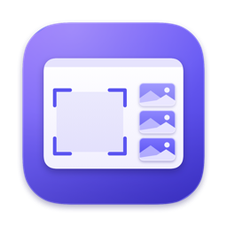

# Margin

Screenshots that wait in the margin of your screen until you drag them where they belong. Native macOS.

<!-- TODO before release: a screenshot or short GIF of the shelf with a few captures on the right edge. -->

Every capture is saved to disk, copied to the clipboard, and put on a shelf of thumbnails at the right edge of the screen. A thumbnail stays there until you drag it into another app or dismiss it.

## Features

- **Instant capture.** Area, window and full-screen shots on a frozen screen. Releasing the mouse captures; there is no extra confirm step.
- **Saved and copied every time.** Each shot lands in `~/Desktop/Screenshots` as a PNG (24-hour names, never a half-written file) and on the clipboard, ready for ⌘V.
- **The shelf.** Thumbnails stack on the right edge, newest at the bottom. Drag one into Slack, Chrome, Finder or Terminal; it leaves the shelf when the drop lands. Older shots fold into a `+N older` pile.
- **Precise selection.** Pixel loupe with the colour under the cursor, snapping to window edges, resize handles, arrow-key nudging, ⇧ for a square, ⌥ from the centre.
- **Window mode.** Press Space while selecting to capture a single window with transparent corners and no shadow (hold ⌥ to keep it).
- **Repeat last area.** ⌘⇧2 captures the same rectangle again with no overlay.
- **Stays out of the way.** No Dock icon, the shelf never takes focus, tucks away with ⌘⇧1, and never appears in its own screenshots.
- **Undo.** ⌘Z brings back anything that left the shelf, including files you moved to the Trash from it.

## Shortcuts

| Keys | Action |
|---|---|
| ⌘⇧4 | Capture an area. Press Space for window mode |
| ⌘⇧3 | Capture the screen under the pointer |
| ⌘⇧2 | Repeat the last area (no overlay) |
| ⌘⇧1 | Tuck or show the shelf |
| ⌃⌘⇧4 · ⌃⌘⇧3 · ⌃⌘⇧2 | Same as without ⌃ (every shot is already copied) |

While selecting: drag, then release to capture · ⇧ square · ⌥ from centre · hold Space to move · ←↑→↓ nudge (⇧ for 10 px) · ↩ capture · Esc cancel.

On the shelf (click it first): click to copy · drag to send · ⌘-click to select several · Space for Quick Look · ⌫ to dismiss · double-click to open · ⌘Z to undo.

All four shortcuts can be changed in Settings. ⌘⇧5 stays with macOS for screen recording.

## Install

Margin needs macOS 26 (Tahoe) or later on Apple silicon.

1. Download `Margin-0.0.1.zip` from [Releases](https://github.com/Jenish-Shobhit/margin/releases).
2. Unzip it and move **Margin.app** to `/Applications`.
3. Open it. Version 0.0.1 isn't notarized, so macOS blocks the first launch. Go to **System Settings › Privacy & Security**, scroll down, and click **Open Anyway**.

## First run

A small window walks you through three steps:

1. **Allow Screen Recording.** Margin needs it to see the screen. Grant it in System Settings › Privacy & Security › Screen & System Audio Recording, then relaunch Margin if asked.
2. **Hand over the shortcuts.** Turn off the four macOS screenshot shortcuts (⌘⇧3, ⌃⌘⇧3, ⌘⇧4, ⌃⌘⇧4) in System Settings › Keyboard › Keyboard Shortcuts › Screenshots, so Margin receives them. The checklist updates live.
3. **Take your first shot.** Press ⌘⇧4. Launch at login is on; you can change it in Settings.

Until step 2 is done, everything also works from the menu bar icon.

## Build from source

You need the Xcode Command Line Tools (Swift 6). Xcode itself isn't required.

```sh
git clone https://github.com/Jenish-Shobhit/margin.git
cd margin
scripts/build.sh --install --run
```

`scripts/build.sh` builds a release `Margin.app` (arm64), signs it, and with `--install` replaces `/Applications/Margin.app`. Other options: `--debug`, `--run`, `--zip` (writes `dist/Margin-<version>.zip`; release builds only). A debug build carries a control hook for `scripts/debug.sh`, so the script refuses to zip one and warns loudly when you install one.

**Optional, recommended:** create a self-signed code-signing certificate named **Margin Dev** (Keychain Access › Certificate Assistant › Create a Certificate…, type *Code Signing*). The build script uses it when present, so the Screen Recording permission survives rebuilds. Without it the app is signed ad-hoc and macOS asks for permission again after every build.

Run the tests with `scripts/test.sh`. Debug builds also listen for `scripts/debug.sh` commands (`capture-area x y w h`, `capture-screen`, `toggle-shelf`, `clear`, `dump-state`).

The icon is drawn by `swift scripts/make-icon.swift`, which writes `Resources/AppIcon.icns`.

## Privacy

Margin never connects to the network and has no analytics, accounts or telemetry. Screenshots are written only to the folder you choose (and, if that folder can't be written, to `~/Library/Application Support/Margin/Unsaved/`). The shelf's list of shots is stored locally in `~/Library/Application Support/Margin/shelf.json`.

## License

[MIT](LICENSE) © 2026 Jenish Shobhit
