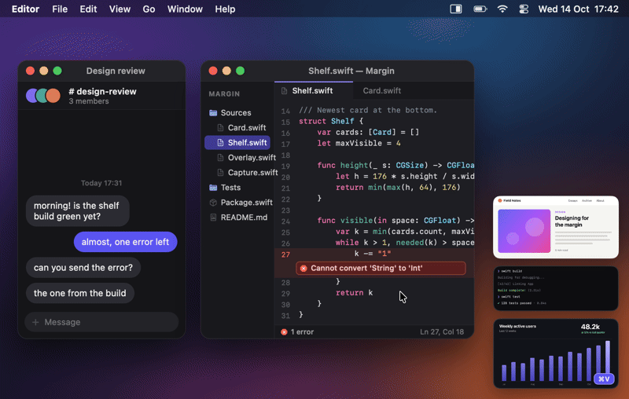

<p align="center">
  
</p>

<h1 align="center">Margin</h1>

<p align="center">
  Screenshots that wait in the margin of your screen until you drag them where they belong.<br>
  A native macOS menu bar app.
</p>

<p align="center">
  <a href="https://github.com/Jenish-Shobhit/margin/releases/latest"></a>
  <a href="LICENSE"></a>
  
  
  
</p>



Every capture is saved to disk, copied to the clipboard and put on a shelf of thumbnails at the right edge of the screen. A thumbnail stays there until you drag it into another app or dismiss it.

## Why Margin

- **Saved and copied, every time.** Each shot is a PNG in `~/Desktop/Screenshots` and on the clipboard. There's no preview to dismiss and no "save?" step.
- **A shelf that waits.** The thumbnail stays at the edge of the screen until you drag it somewhere. It's still there after you quit or restart.
- **Never in its own shots.** The shelf, the selection overlay, toasts and the fly-in animation are left out of every capture.
- **Instant.** ⇧⌘4 freezes the screen at once, and letting go of the mouse captures. There's no confirm step.
- **⌘V works in terminals.** The clipboard carries the image *and* the saved file, so ⌘V in Ghostty pastes the file's path and Claude Code attaches the screenshot.

## Features

**Capture**

- Area capture on a frozen screen: drag and release. ⇧ makes a square, ⌥ draws from the centre and holding Space moves the selection.
- Fine-tune before capturing with resize handles and arrow-key nudging (1 px, or 10 px with ⇧). Edges snap to window edges.
- A magnifier on demand (Z): an 11 × 11 pixel grid with the position and colour under the pointer.
- Window mode (Space): just one window, with transparent rounded corners and no shadow. Hold ⌥ to keep the shadow.
- Full screen of the display under the pointer (⇧⌘3), and the last area again with no overlay (⇧⌘2).
- Works across several displays, including ones with different scales.

**Screen recording**

- ⇧⌘5 records an area (drag), a window (Space, then click) or the whole display (click). ⇧⌘5 again stops; the menu bar shows a red stop button and the time meanwhile.
- MP4 (H.264, AAC) at the display's Retina resolution and refresh rate up to 60 fps, with the pointer, from the hardware encoder. Screenshots keep working while you record, and Margin's shelf and overlay stay out of the movie.
- System audio and the microphone, both off until you turn them on in Settings.
- Recordings land on the shelf with their first frame and length: drag, click to copy the file, Space to play it in Quick Look.

**Save and copy**

- PNGs named `Screenshot 2026-10-14 at 17.42.17.png` (24-hour time), written atomically so no app ever sees half a file.
- Keeps the display's colour profile and the Retina DPI (144), and tags the file as a screenshot (Finder and Spotlight's screenshot searches find it), as macOS does.
- The clipboard gets the PNG and the saved file. The shutter sound follows your alert volume.
- Or don't keep them: with **Delete screenshots after pasting** on, a screenshot waits on the shelf only until you paste it (⌘V) or drag it into an app, and its file goes once Restore Last Removed can't bring it back. Screen recordings are always saved.

**The shelf**

- Up to six cards on the right edge of the display you last captured on, newest at the bottom. Older shots fold into a `+N older` pile.
- Drag a card into Finder, Slack, Chrome, WhatsApp, Terminal or any other app. It leaves the shelf when the drop lands; the file is never moved or deleted.
- Click to copy again, Space for Quick Look, double-click to open. Rename, Reveal in Finder, Copy Path and Move to Trash are in each card's menu.
- ⌘Z (or **Restore Last Removed** in the menu bar) brings back the last 20 removals, including files you moved to the Trash.
- Done with them for now? **✕ Close Shelf**, above the top card, takes every card off at once; the files stay in your folder, and Restore Last Removed brings them back.
- ⇧⌘1 tucks the shelf into a small tab. It never takes focus from the app you're in, and it's there on every Space and over full-screen apps.
- Follows files you rename or move in Finder.

**The app**

- Menu bar only, with no Dock icon. A three-step first-run guide, a Settings window with General, Shortcuts and Recording panes, and launch at login.
- Supports light and dark mode, Reduce Motion and Reduce Transparency.

## Install

1. Download `Margin-<version>.zip` from [Margin's website](https://jenish-shobhit.github.io/margin/) or the [latest release](https://github.com/Jenish-Shobhit/margin/releases/latest).
2. Unzip it and move **Margin.app** to `/Applications`. Keep it there: the Screen Recording permission belongs to that copy, and launch at login only registers from `/Applications`.
3. Open Margin. It isn't notarized yet, so macOS blocks the first launch:
   1. In the "Margin" Not Opened dialog, click **Done** (not Move to Trash).
   2. Open **System Settings › Privacy & Security** and scroll down to **Security**.
   3. Next to "Margin" was blocked…, click **Open Anyway**, then confirm with your password or Touch ID.

You only do this once per download. If it still won't open, see [Troubleshooting](docs/troubleshooting.md#margin-cant-be-opened).

**Updating:** choose **Check for Updates…** from the menu bar icon, or click **Update Margin** on the website. Margin also checks once a day. It downloads the new version, checks it's signed like the one you have, and replaces itself, so there's no Open Anyway the next time ([user guide](docs/user-guide.md#updates)).

**Requirements:** macOS 26 (Tahoe) or later on Apple silicon. Intel Macs aren't supported.

## First run

A small window walks you through three steps:

1. **Allow Screen Recording.** Click **Allow…**, then turn Margin on in System Settings › Privacy & Security › Screen & System Audio Recording. If macOS doesn't pick it up, click **Relaunch Margin**.
2. **Hand over the shortcuts.** Click **Turn off for me**. Margin turns off the five macOS screenshot shortcuts (⇧⌘3, ⌃⇧⌘3, ⇧⌘4, ⌃⇧⌘4 and the ⇧⌘5 toolbar) so it receives those keys. It takes effect at once, with no logout.
3. **Take your first shot.** Press ⇧⌘4. The window closes after your first capture.

Launch at login is on by default. If you skip step 2, the menu bar menu offers "macOS still uses ⇧⌘4 — Fix…" to bring it back. Everything also works from the menu bar icon.

## Everyday use

1. Press ⇧⌘4 and drag over what you want. Let go: the shot is saved, copied and flies onto the shelf.
2. Paste it with ⌘V, or drag its card into any app.
3. Click a card to copy it again. A small **⌘V** pill marks the card that's on the clipboard.
4. Press ⇧⌘1 to tuck the shelf away, and again to bring it back.

The [user guide](docs/user-guide.md) covers everything else.

## Shortcuts

All five global shortcuts can be changed in Settings. The full list is in [docs/shortcuts.md](docs/shortcuts.md).

**Global**

| Keys | Action |
|---|---|
| ⇧⌘4 | Capture an area (press Space for window mode) |
| ⇧⌘3 | Capture the screen under the pointer |
| ⇧⌘2 | Capture the last area again, with no overlay |
| ⇧⌘5 | Record the screen: drag an area, Space for a window, click for the whole display. Again to stop |
| ⇧⌘1 | Tuck or show the shelf |
| ⌃⇧⌘4 · ⌃⇧⌘3 · ⌃⇧⌘2 · ⌃⇧⌘5 | Same as without ⌃ (every shot is already copied) |

**While selecting**

| Keys | Action |
|---|---|
| Drag, then release | Capture the area |
| ⇧ / ⌥ while dragging | Square / draw from the centre |
| Hold Space while dragging | Move the selection |
| Space | Switch between area and window mode |
| ←↑→↓ | Nudge 1 px (⇧ for 10 px; holding speeds up) |
| Z | Show or hide the magnifier |
| ⌥-click (window mode) | Capture the window with its shadow |
| ↩ | Capture the adjusted selection |
| Esc or right-click | Cancel |

**On the shelf** (a click copies and leaves the keyboard with your app; the other keys work after a ⌘-click or ✕)

| Keys | Action |
|---|---|
| Click | Copy the shot |
| Drag | Send it to another app (hold ⌥ at the drop to keep the card) |
| ⌘-click · ⌘A | Select several · select all |
| ⌘C | Copy the selected shots |
| Space | Quick Look |
| ⌫ | Dismiss (the file stays on disk, unless Delete screenshots after pasting is on) |
| Double-click | Open in the default app |
| ⌘Z | Bring back what was last removed |

## Clipboard

Each capture (with **Copy each capture** on) and each copy from the shelf puts one clipboard item per shot. It holds the PNG, with the same bytes as the file, and the saved file itself. Each app picks the form it understands:

| Where you paste | What you get |
|---|---|
| Notes, Pages, Mail, image editors | The image |
| Chrome and Chromium-based apps (claude.ai in Chrome, Slack) | The PNG file, uploaded under its real name |
| Ghostty (⌘V) | The file's path, shell-escaped. In Claude Code, that attaches the screenshot |
| Claude Code in any terminal (Ctrl+V) | The image, read straight from the clipboard |
| Other terminals (⌘V) | Depends on the terminal. Use Ctrl+V in Claude Code, or drag the card in to type its path |

- The clipboard is written once the PNG is on disk, a fraction of a second after the capture.
- Only the newest capture writes the clipboard, and a copy you make from the shelf meanwhile wins.
- If a shot couldn't be saved, the clipboard gets the image only.
- **Copy Path** in a card's menu puts the path as plain text.
- A screen recording is copied as its file only (`public.file-url`): apps that take a pasted file get the movie, a terminal its path.
- The ⌘V pill clears within about a second once something else is copied.

## Settings

Open **Settings…** from the menu bar icon. It has three panes: **General** (the first seven below), **Recording** (the audio) and **Shortcuts**.

| Setting | Default | |
|---|---|---|
| Save to | `~/Desktop/Screenshots` | Created when missing |
| Copy each capture | On | Off leaves the clipboard alone; click a card to copy it |
| Delete screenshots after pasting | Off | Screenshots go to Margin's own folder, and one you paste or drag into an app leaves the shelf and is deleted once undo can't bring it back. A clipboard manager that saves images keeps pastes from being noticed ([user guide](docs/user-guide.md#delete-screenshots-after-pasting)) |
| Shutter sound | On | Silent when "Play user interface sound effects" is off in System Settings › Sound |
| Show key hints while capturing | On | The bar of keys at the top of the screen while you select |
| Check for updates automatically | On | At launch and once a day, asks GitHub for the latest release |
| Launch at login | On | Shows what macOS really has, including "waiting for approval" |
| Record system audio | Off | Recordings include what the Mac plays (not Margin's own sounds) |
| Record microphone | Off | Recordings include the microphone; turning it on asks for permission |
| Shortcuts | ⇧⌘4 · ⇧⌘3 · ⇧⌘2 · ⇧⌘1 · ⇧⌘5 | Capture area, Capture screen, Repeat last area, Show or tuck shelf, Record screen |

Under the shortcuts, **macOS Screenshot Shortcuts** shows whether macOS still owns ⇧⌘3, ⇧⌘4 and ⇧⌘5, with **Turn Off**, or **Restore** once they're all off.

## Privacy

Margin works entirely on your Mac. It has no analytics, no telemetry and no accounts. Its one network request is the update check: it asks GitHub for the latest release and sends nothing about you. Turn it off in Settings, and Margin goes online only when you choose **Check for Updates…**.

| What | Where |
|---|---|
| Screenshots and screen recordings | Your save folder (default `~/Desktop/Screenshots`). If that can't be written: `~/Library/Application Support/Margin/Unsaved/`. With **Delete screenshots after pasting** on, screenshots stay in `~/Library/Application Support/Margin/Pasteboard/` only until they're pasted |
| The shelf's list (paths, Finder bookmarks, dates, pixel sizes) | `~/Library/Application Support/Margin/shelf.json` |
| Settings, shortcuts, the last area for ⇧⌘2, a few counters | The preferences domain `io.github.jenish-shobhit.margin` |
| Diagnostics (timings, saved file names, errors) | The macOS unified log, subsystem `io.github.jenish-shobhit.margin`, like any app's logs |

- Margin asks for Screen Recording. macOS also asks before it first writes to your Desktop folder, and for the microphone only if you turn on **Record microphone**. Recordings stay on your Mac like screenshots.
- It changes the macOS screenshot shortcuts (`com.apple.symbolichotkeys`) only when you click **Turn off for me** (first run), or **Turn Off** or **Restore** in Settings › Shortcuts.
- [SECURITY.md](SECURITY.md) lists everything the app touches.

## Uninstall

1. **Restore the macOS screenshot shortcuts first.** Open Margin's Settings, go to **Shortcuts** and click **Restore** under macOS Screenshot Shortcuts. If the button reads **Turn Off** instead, some are already on; turn the others back on in System Settings › Keyboard › Keyboard Shortcuts… › Screenshots.
2. In **General**, turn off **Launch at login**. That removes the login item.
3. Quit Margin from its menu bar icon (**Quit Margin**).
4. Delete `/Applications/Margin.app`.
5. Remove its data and preferences. Look in `Unsaved` for any screenshots you want to keep first.

   ```sh
   rm -rf ~/Library/Application\ Support/Margin
   defaults delete io.github.jenish-shobhit.margin
   ```

6. Optional: clear its privacy permissions with `tccutil reset All io.github.jenish-shobhit.margin`. If Margin still shows in System Settings › General › Login Items, remove it there.

Your screenshots stay in your save folder.

## Building from source

You need the Xcode Command Line Tools (Swift 6.2 or later); Xcode isn't required.

```sh
git clone https://github.com/Jenish-Shobhit/margin.git
cd margin
scripts/build.sh --install --run
```

Create a self-signed **Margin Dev** code-signing certificate first, or macOS asks for Screen Recording again after every build. [docs/building.md](docs/building.md) covers the certificate, tests, the debug hook and releases.

## Documentation

- [User guide](docs/user-guide.md): everything Margin does, step by step.
- [Shortcuts](docs/shortcuts.md): the complete reference.
- [Troubleshooting](docs/troubleshooting.md): Gatekeeper, permissions, shortcuts, pasting and the shelf.
- [Building](docs/building.md): the toolchain, signing, tests, the debug hook and releases.
- [Architecture](docs/architecture.md): how the code fits together.
- [QA checklist](docs/QA.md): the manual checks run before each release.

## Contributing

Bug reports and focused pull requests are welcome. Read [CONTRIBUTING.md](CONTRIBUTING.md) first: Margin is deliberately a screenshot tool, nothing more. Report security issues privately as described in [SECURITY.md](SECURITY.md).

## License

[MIT](LICENSE) © 2026 Jenish Shobhit

## Acknowledgements

Margin is shaped by tools that got screenshots right before it: [CleanShot X](https://cleanshot.com), [Shottr](https://shottr.cc), [Dropover](https://dropoverapp.com), [Yoink](https://eternalstorms.at/yoink/) and macOS's own screenshot tool. They're inspiration only: Margin shares no code with them and has no third-party dependencies.
