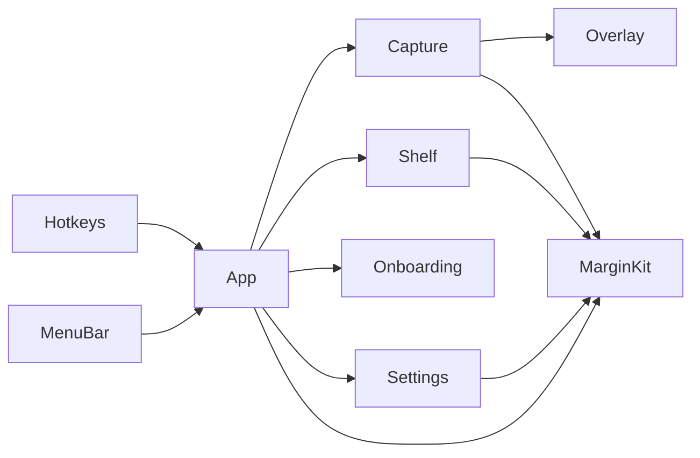
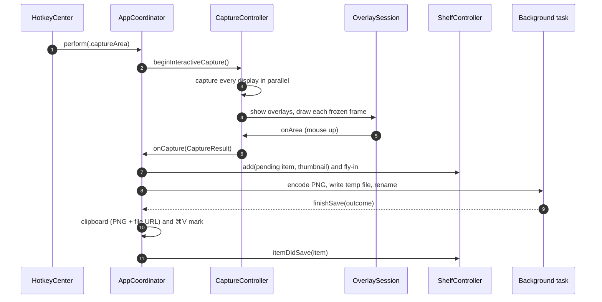

# Architecture

How Margin 0.0.7 is put together, for anyone changing it. The product rules live in [`spec.md`](../spec.md); this page describes the code that implements them.

- [Targets and folders](#targets-and-folders)
- [The contracts](#the-contracts)
- [From hotkey to shelf](#from-hotkey-to-shelf)
- [Threading rules](#threading-rules)
- [Windows and focus](#windows-and-focus)
- [Persistence](#persistence)
- [Permissions](#permissions)
- [Hotkeys](#hotkeys)
- [The macOS screenshot shortcuts](#the-macos-screenshot-shortcuts)
- [Debug builds](#debug-builds)

## Targets and folders

`Package.swift` defines three targets. There are no external dependencies.

| Target | Kind | What's in it |
|---|---|---|
| `MarginKit` | Library | Pure logic with no windows. Everything here is unit-tested |
| `Margin` | Executable | The app: AppKit and SwiftUI. Depends on `MarginKit` |
| `MarginKitTests` | Tests | Swift Testing suites for `MarginKit` |

**`Sources/MarginKit/`**

| File | Responsibility |
|---|---|
| `FileNamer.swift` | `Screenshot yyyy-MM-dd at HH.mm.ss.png` (en_US_POSIX, 24-hour, ASCII spaces) and ` (2)` collisions |
| `Geometry.swift` | AppKit ↔ CG coordinate flips, point → pixel rects, snapping to window edges |
| `ShelfLayout.swift` | Card sizes, slots, how many cards fit and the `+N older` pile |
| `ShelfStore.swift` | `ShelfItem` (path, bookmark, date, pixel size; whether its volume is mounted) and the ordered, JSON-persisted list |
| `PNGWriter.swift` | One ImageIO encode (no filtering, colour profile, DPI) and the atomic write: temp file, then an exclusive rename |
| `ClipboardMark.swift` | The ⌘V mark's change-count bookkeeping, and `ClipboardWriter` (PNG + file URL per item) |
| `Preferences.swift` | `KeyCombo`, `ShortcutAction` (defaults, ⌃ twins, conflicts), `LastArea` and the `Preferences` store |
| `KeyCombo+Display.swift` | `⇧⌘4`-style strings in ⌃⌥⇧⌘ order, key names and Carbon ↔ AppKit modifiers |
| `KeyboardLayout.swift` | What the character keys type on the user's keyboard layout (`UCKeyTranslate`), so shortcuts read as the keys are labelled. A snapshot taken on the main thread at launch and on every input source change |
| `RuntimeStatus.swift` | Live state shared across the app: hotkey failures, revoked Screen Recording |
| `SystemShortcuts.swift` | Reading the macOS screenshot shortcuts (IDs 28–31) |
| `SystemShortcuts+Write.swift` | Turning them off or on: the pure dictionary rewrite, `activateSettings -u`, and the check that it stuck |
| `LoginItem.swift` | `SMAppService.mainApp` state and registration |
| `ShelfUndo.swift` | `UndoSequencer`: the shelf's ⌘Z one step at a time, so a quick second ⌘Z waits for a slow first one. `TrashedFile.putBack`: a trashed shot back home (or already there, after Finder's Put Back) |
| `ShutterSound.swift` | The system Screen Capture sound, honouring "Play user interface sound effects" |

**`Sources/Margin/`**

| Folder | Responsibility |
|---|---|
| `App/` | `main.swift` (accessory app), `AppDelegate`, `AppCoordinator` (wires everything, permission state, ⌘V mark), `AppCoordinator+Save` (the save pipeline), `Contracts.swift`, and `MainMenu` (a hidden main menu that gives text fields and windows their standard key equivalents) |
| `Capture/` | `CaptureController` (area, window, screen, repeat area), `ScreenGrabber` (ScreenCaptureKit calls and cropping), `ShareableContentCache`, `Displays`, logging and timings, and `CaptureSimulation` (DEBUG-only fakes) |
| `Overlay/` | The frozen-screen overlay: `OverlayPanel` and its pool, `OverlaySession` (selection state machine and keys), `OverlayView` (layers), `OverlayChrome` (hint bar, magnifier, pills), `SelectionMath` and `AreaFlash` |
| `Shelf/` | `ShelfController` (layout, tuck, peek, toasts) and its extensions: `+Actions` (every interaction, undo, drag-out) and `+Files` (disk checks). Also the views (`ShelfCardView`, `ShelfPileView`, `ShelfChrome`), `ShelfDrag`, `ShelfFlyIn`, `ShelfFiles` (all disk access), `ShelfThumbnails` and `ShelfStyle` |
| `Hotkeys/` | `HotkeyCenter`: Carbon registration |
| `MenuBar/` | `StatusMenuController` (icon, warning dot, menu rebuilt on open) and `MenuKeyEquivalent` |
| `Onboarding/` | The first-run window: `FirstRunModel` (polled state), `FirstRunView` (SwiftUI) and its window controller |
| `Settings/` | `SettingsModel` (`@Observable`, shortcut recording), `SettingsView` (SwiftUI form) and its window controller |
| `Debug/` | `DebugCommandListener`, compiled only under `#if DEBUG` |

## The contracts

`Sources/Margin/App/Contracts.swift` holds the seams between the coordinator, capture and the shelf. The parts were built in parallel against these, so change them deliberately: both sides depend on them.

**`CaptureResult`** is one finished capture:

- `image`: full resolution, in the display's colour space, with transparent corners for windows;
- `scale`: pixels per point, used for the DPI;
- `sourceRect`: the on-screen rect in AppKit global points, where the fly-in starts;
- `displayID`, `kind` (`.area`, `.window` or `.screen`) and `date`.

**`CaptureControlling`** (implemented by `CaptureController`):

- `prewarm()`;
- `beginInteractiveCapture()` and `beginWindowCapture()`;
- `captureScreenUnderPointer()`, `repeatLastArea()` and `captureArea(_:)` (no overlay: used by ⇧⌘2 and the debug hook);
- `isCapturing`;
- the callbacks `onCapture` and `onPermissionMissing`.

`CaptureController` also has `onFailure`, outside the protocol: a short message for any failure but permission, which the coordinator shows as an error toast in the shelf.

**`ShelfControlling`** (implemented by `ShelfController`):

- `restore()` at launch, `add(_:thumbnail:flyInFrom:displayID:)` and `toggleTucked()`;
- `setClipboardMark(_:)`, and the callbacks `onCopied` and `onRemoved`;
- debug state: `itemIDs`, `isTucked` and `markedItemID`;
- **v2, the save lifecycle.** `add` happens before the PNG exists, so the item is *pending* until `itemDidSave(_:)` arrives with the final path and bookmark. A pending item is never pruned, and drag, copy and Quick Look wait for it. `itemSaveFailed(_:message:)` drops the card (with no undo) and shows a toast. `showToast(_:)` and `clear()` complete it.

## From hotkey to shelf

### Before the hotkey: prewarm

At launch, once Screen Recording is confirmed, `CaptureController.prewarm()` gets everything ready so the hotkey path doesn't have to:

- It creates one overlay panel per display and orders each in once, invisibly, so the window server already has their surfaces.
- It fetches `SCShareableContent` into `ShareableContentCache`. That builds a capture target per display, with a filter that excludes Margin's own windows.
- It runs one 16 × 16 capture to warm up ScreenCaptureKit.

After that, the cache refreshes on display, app and Space changes (debounced 150 ms), never on the hotkey path. A fetch that fails, or whose targets don't match the displays yet, is retried up to three times (0.5, 1 and 2 s apart). The cache remembers each display's pixel size at the last fetch: a display that's new, or has changed size or scale since (a refresh still pending or failed), isn't trusted, and its capture fetches first (the cold path).

### The freeze (⇧⌘4)

1. The `AppCoordinator` checks permission without prompting and calls `beginInteractiveCapture()`.
2. If the cache is warm (and every display has the size it had at the last fetch), `SCScreenshotManager.captureImage` starts for every display at once (a task group, off the main thread). At the same time the transparent overlays go up, with a crosshair.
3. Each display's frame is drawn as it arrives. With the first one, Margin activates and makes the overlay key, so Esc, Space and the arrows work.
4. A display that fails is dimmed ("Can't capture this display"). If no frame arrives within 3 s the overlay cancels itself with a "Couldn't capture the screen" toast, so it can never be left eating clicks.
5. As soon as the first display is frozen (not after the slowest one), the window list is refreshed for snapping and window mode: `SCShareableContent` with on-screen windows only, about 60 % of the full fetch, since Margin is listed through its overlay. Not earlier: a fetch started alongside the captures slows them by about 20 ms. When it lands, a selection being drawn re-snaps its start to it and window mode re-picks the window under the pointer; a window-mode click that came first is held until then. (The cold path's fetch already has fresh windows.)

The target is **≤ 80 ms from the hotkey to the first frozen frame**.

### Selecting

`OverlaySession` is a small state machine:

| Phase | Meaning |
|---|---|
| `idle` | Nothing selected yet |
| `dragging` | Releasing captures |
| `pinned` | An arrow key was pressed mid-drag, so releasing keeps the selection |
| `adjusting` | Handles, moving, nudging and ↩ |
| `moving`, `resizing` | Dragging the selection or one of its handles |

Selections are pixel-aligned and limited to the display where they started. Mouse-up in `dragging` calls `onArea` with the rect, the frozen image and the pixel rect. `CaptureController` closes the overlay and crops off the main thread, hands a `CaptureResult` to the coordinator, then gives focus back to the previous app.

The other kinds:

- **Window mode** closes the overlay and waits for the previous app to be active again, so the window is shot with its own focused look. It then captures with `SCContentFilter(desktopIndependentWindow:)`: no shadow unless ⌥ was held.
- **⇧⌘3** captures the display under the pointer with the cached target.
- **⇧⌘2** captures the last area's display, crops it and flashes the outline. `LastArea` keeps the rect relative to its display, with the display's size in points, so it's rebuilt on the display's current frame; at another size it falls back to ⇧⌘4.

### The release (`AppCoordinator+Save`)

On the main actor, in this order:

1. Plays the shutter sound.
2. Predicts the file name with `FileNamer`. It's checked against an in-memory set of names already handed out, *not* the disk.
3. Downsamples a thumbnail from the in-memory image and calls `shelf.add` with a pending item. The fly-in starts here. The target is **≤ 100 ms from release to thumbnail**.

Then, in a detached task:

1. One `PNGWriter.encode` produces the bytes for both the file and the clipboard.
2. `writeAtomically` writes a hidden temp file (`.margin-<uuid>.tmp`) in the save folder, then `renamex_np(RENAME_EXCL)` moves it into place.
   - If the name is taken on disk, it moves on to the next free one.
   - If the folder can't be written, it falls back to `~/Library/Application Support/Margin/Unsaved/`.
3. It makes a Finder bookmark for the final file. The target is **≤ 200 ms from release to the PNG renamed into place**.

Back on the main actor, `finishSave`:

1. Writes the clipboard, if **Copy each capture** is on and this is still the newest capture (a copy from the shelf since then wins). It writes one item per shot: `public.png`, plus `public.file-url` pointing at the *final* path. It records the pasteboard's `changeCount` and puts the ⌘V mark on the card.
2. Stores the final path and bookmark, and calls `shelf.itemDidSave`.
3. Shows the "Saved to Unsaved" toast if needed, bumps the capture counter, and tells first run.

If saving fails completely, the card goes with "Couldn't save the screenshot". The clipboard gets the PNG alone, if it's still the newest capture.

Quitting while saves are in flight answers `.terminateLater`. Margin waits for them, at most 3 s, on a run-loop timer that also fires during the termination modal loop.

### On the shelf

- `ShelfFlight` animates the thumbnail from the selection to its slot in about 0.45 s, in a temporary click-through panel. It re-aims if the slot moves (another capture, a tuck, a peek), lands in the tab or the pile when that's where the card is, and then hands off to the real card. The card's accent ring lasts 1.5 s.
- A one-second timer compares the pasteboard's `changeCount` with the one recorded after Margin's last write. When they differ, the ⌘V mark clears. Margin never reads the clipboard's contents.
- Drag-out writes a plain `NSURL` per item and offers `.copy` only. A non-empty drop operation without ⌥ removes the cards, as one undo step.

## Threading rules

- **UI and app state are `@MainActor`.** That covers AppKit and SwiftUI, `Preferences`, `ShelfStore` and `RuntimeStatus`. The package uses the Swift 6 language mode with strict concurrency.
- **The main thread never touches the save folder.** The first access to `~/Desktop` can block on the Desktop-folder privacy prompt, and the save folder could be on a slow volume. So these all run in detached tasks:
  - writing PNGs and checking whether shelf files exist (`ShelfFiles`);
  - reading a file to copy it, renaming, trashing and untrashing;
  - loading thumbnails from disk;
  - creating the folder for **Open Screenshots Folder**;
  - Settings' folder icon.

  Even the predicted file name is checked against memory, not the disk. Results come back to the main actor, and a background check is applied only to items that haven't changed since it started.
- **ScreenCaptureKit and pixel work run off the main thread:** captures, crops, encodes and downsampling files. `SCShareableContent` is never fetched on the hotkey path.
- **Nothing touches ScreenCaptureKit before permission is confirmed.** An early call can raise the system prompt at a random moment, long before the user reaches **Allow…**. `CGPreflightScreenCaptureAccess` (6–10 ms) runs on the hotkey path only until access is confirmed.
- **Blocking system work stays off the main thread.** `SystemShortcuts.setEnabled` waits on `activateSettings` and asserts it isn't on the main thread; the UI calls `setEnabledInBackground`.
- **The one exception is `shelf.json`.** It lives in Application Support, which never prompts, and it's read and written on the main actor.

## Windows and focus

| Window | Level | Notes |
|---|---|---|
| Capture overlay (one per display) | `.screenSaver + 1` | Borderless, non-activating, made once and reused. Swallows ⌘ shortcuts |
| ⇧⌘2 outline | `.screenSaver + 1` | Click-through, 150 ms |
| Shelf | `.screenSaver` | Borderless, **non-activating** `NSPanel`; hidden when empty |
| Fly-in | `.screenSaver` | Click-through, one per shot in the air |

All of them join every Space and float over full-screen apps.

**Focus.** The shelf becomes key (`focusShelf`) only on a mouse-up whose next step is a shelf key: ⌘-click, ✕, the pile, Rename…, Move to Trash, Clear shelf. Never on a plain click (copy) or a double-click (open), so ⌘V right after a click reaches the user's app; never on a press that turns into a drag; and never by activating Margin. Its keys (⌘C, ⌘Z, ⌘A, Space, ⌫, Esc) then work while the menu bar still belongs to the other app. `releaseKeys` gives the keyboard back on Esc, after every copy (click, ⌘C, Copy Path) and when the shelf goes out of sight (tuck, end of a peek; a rename in progress is saved first): `NSApp.deactivate()` makes the other app's window key again, unless Margin itself is frontmost.

`MainMenu` installs a hidden main menu, so text fields get their standard edit keys. Its ⌘Q acts only while Margin is really frontmost (`NSRunningApplication.current.isActive`), and its Undo goes to the rename field's own undo manager while it's editing.

**Exclusion from captures.** Every capture filter excludes Margin's application, except its ordinary windows: everything of Margin's below the pop-up menu level, so Settings, First run, About, open panels and (where AppKit draws it in-process) the menu bar icon appear in shots and can be picked in window mode like any app's. The capture UI sits at the pop-up menu level or above (menus, the shelf and fly-in at `.screenSaver`, the overlay and ⇧⌘2 outline at `.screenSaver + 1`), and because the app itself is excluded, a window made after the last fetch (each fly-in) is never in a shot. The other way round, an ordinary window the cache doesn't know yet is cut out until the refresh it schedules when it becomes key or visible. `SCShareableContent` lists Margin, and so lets it be excluded, only while Margin owns at least one window. That's why the overlay panels exist from prewarm on, and why ⇧⌘3 makes sure of them even without a prewarm.

## Persistence

| Store | Where | Contents |
|---|---|---|
| `Preferences` | `UserDefaults`, domain `io.github.jenish-shobhit.margin` | `saveFolder`, `copyEachCapture`, `shutterSound`, `launchAtLogin`, `shortcut.<action>` (JSON `KeyCombo`), `lastArea` (JSON: rect relative to its display, display ID, display size), `firstRunDone`, `completedCaptures`, `hintCaptures.r<n>`, `loginItemConfigured` |
| `ShelfStore` | `~/Library/Application Support/Margin/shelf.json` | The shelf, oldest first: `id`, `path`, `bookmark`, `createdAt`, `pixelWidth`, `pixelHeight`. Rewritten atomically on every change; an unreadable file means an empty shelf |
| Fallback saves | `~/Library/Application Support/Margin/Unsaved/` | PNGs that couldn't go to the save folder |
| Undo | Memory | Up to 20 steps. Thumbnails are kept for the newest 5. Steps restore one at a time (`UndoSequencer`), since each goes back to the indices it had, which holds only once newer steps are back |
| `RuntimeStatus` | Memory | Hotkey failures and revoked Screen Recording |

More on how these behave:

- **`Preferences.didChange`** is posted on every write. The hotkeys, Settings and the menu observe it, and `HotkeyCenter` re-registers only when the shortcuts actually changed.
- **The hint bar** shows while `Preferences.showsCaptureHints` is on (the default; a Settings toggle).
- **Bookmarks** let a card follow a file renamed or moved in Finder.
- **When a shelf file counts as gone:** `ShelfFiles.status` tells a file that's definitely gone (`ENOENT` on a mounted volume, or in a `.Trash` folder) from one Margin can't see right now (access denied, or its volume isn't mounted: `ShelfItem.isOnUnmountedVolume` checks the mount point the bookmark recorded, or `/Volumes/<name>`). Only the first drops the card, so a folder Margin may not read, or an unplugged disk, never empties the shelf.
- **When files are checked:** at launch, when the shelf appears, and on a mouse-down that may become a drag.

## Permissions

- **Screen Recording.**
  - **At launch:** `CGPreflightScreenCaptureAccess` only. `CGRequestScreenCaptureAccess` runs only when the user clicks **Allow…**.
  - **Without permission:** a capture shortcut opens first run at step 1 instead of touching ScreenCaptureKit.
  - **Revocation:** preflight is cached per process, so a revocation while running shows up as a capture error (`SCStreamError.userDeclined`). That sets `RuntimeStatus.screenRecordingRevoked`, which keeps the warning up until a capture succeeds or Margin relaunches.
  - **Relaunch Margin** starts `/bin/sh`, which waits for this process to exit and then `open`s the bundle. It deliberately doesn't use `open -n`, so there's never a second copy.
- **Files.** The default save folder is in `~/Desktop`, so macOS shows its Desktop-folder prompt on first write. That's the reason for the off-main rule. A denied write falls back to Unsaved.
- **Launch at login** uses `SMAppService.mainApp`. It's registered once, on the first launch from `/Applications` (never from a dev copy elsewhere). Settings shows `SMAppService`'s real status, including "requires approval".
- **No Accessibility or Input Monitoring.** Carbon hotkeys don't need them.

## Hotkeys

`HotkeyCenter` registers with Carbon's `RegisterEventHotKey` on the application event target, with the signature `'MRGN'`.

- **What it registers:** `Preferences.registeredCombos()`, which is each action's shortcut plus the ⌃ twin of each capture action.
- **When it re-registers:** whenever the shortcuts change.
- **While recording:** everything is unregistered while a Settings recorder is listening (`Preferences.isRecordingShortcut`), so pressing the current shortcut records it instead of firing it.
- **Failures:** two actions on one combo, Carbon's `eventHotKeyExistsErr`, or any other `OSStatus`. They go to `RuntimeStatus.hotkeyFailures`. The menu bar shows a warning dot and an item that opens Settings, and Settings shows a message under the shortcut.
- **macOS's own shortcuts:** while the macOS screenshot shortcuts are on, macOS takes ⇧⌘3 and ⇧⌘4 first, but registration still succeeds. That's why that clash is detected separately (below).

## The macOS screenshot shortcuts

**Reading** (`SystemShortcuts.current()`) costs little:

- It reads `AppleSymbolicHotKeys` from `com.apple.symbolichotkeys` with `CFPreferencesCopyAppValue`, after synchronizing.
- IDs 28–31 are the four screenshot shortcuts. A missing entry means enabled.
- `conflicts(_:with:)` lists the enabled ones whose binding is one of Margin's combos.
- It runs when the menu opens, every second while first run is open, and when Settings opens or becomes key.

**Writing** (`SystemShortcuts.setEnabled`) happens only when the user clicks **Turn off for me**, **Turn off macOS screenshot shortcuts** or **Restore macOS screenshot shortcuts**:

1. `applying(enabled:ids:to:)`, a pure function, sets `enabled` for 28–31 and keeps everything else: other IDs, each entry's `value` (so a binding the user changed survives), and any other keys. A missing entry gets the macOS default binding. If the stored value isn't a dictionary at all, nothing is written.
2. The result is written with `CFPreferencesSetAppValue` and synchronized.
3. `/System/Library/PrivateFrameworks/SystemAdministration.framework/Resources/activateSettings -u` runs, with a 5 s timeout, so the change applies without logging out.
4. Margin waits until the saved preferences and the live state agree for 0.3 s. It reads the live state through SkyLight's private `CGSIsSymbolicHotKeyEnabled`, read-only, loaded with `dlsym`.
   - Something can write a half-applied snapshot back, such as System Settings open on its Keyboard pane. So it writes and activates again, up to three tries, before it reports "didn't stick".
   - If the setting is saved but activation fails, the UI says it will apply after the next login.

## Debug builds

`#if DEBUG` adds `DebugCommandListener`, which receives distributed notifications from `scripts/debug.sh`: `capture-area`, `capture-screen`, `toggle-shelf`, `clear` and `dump-state`. It also adds `CaptureSimulation`, which fakes extra displays and failing captures for testing.

Release builds contain neither. [Building › The debug hook](building.md#the-debug-hook) has the commands and the safety rules.
