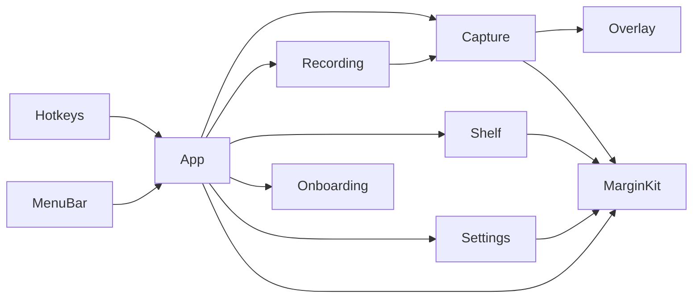
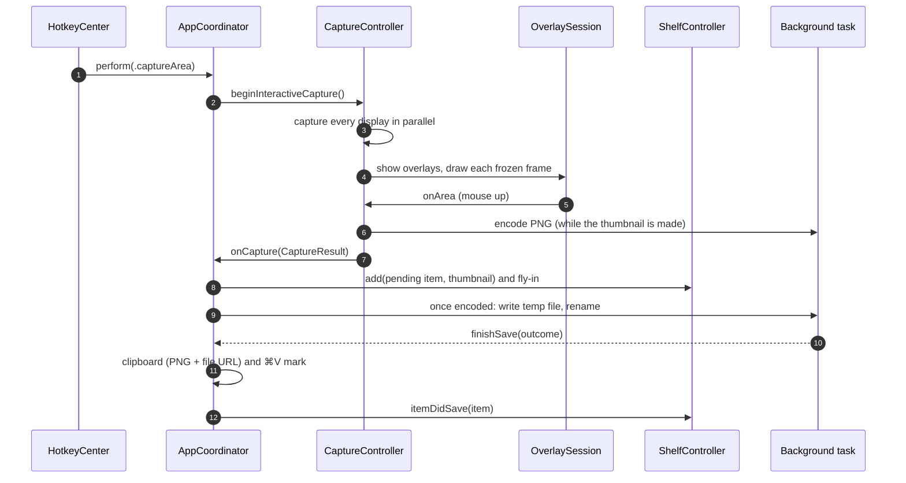
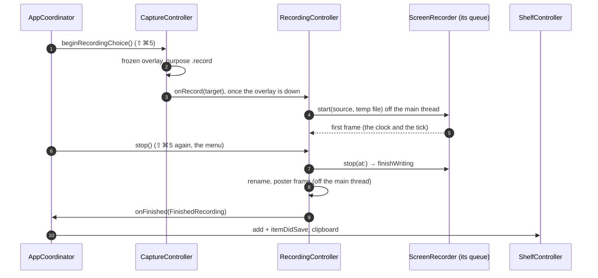

# Architecture

How Margin 0.1.2 is put together, for anyone changing it. The product rules live in [`spec.md`](../spec.md); this page describes the code that implements them.

- [Targets and folders](#targets-and-folders)
- [The contracts](#the-contracts)
- [From hotkey to shelf](#from-hotkey-to-shelf)
- [Screen recording](#screen-recording)
- [Delete screenshots after pasting](#delete-screenshots-after-pasting)
- [Threading rules](#threading-rules)
- [Windows and focus](#windows-and-focus)
- [Persistence](#persistence)
- [Permissions](#permissions)
- [Hotkeys](#hotkeys)
- [The macOS screenshot shortcuts](#the-macos-screenshot-shortcuts)
- [Debug builds](#debug-builds)
- [Updates](#updates)

## Targets and folders

`Package.swift` defines three targets. There are no external dependencies.

| Target | Kind | What's in it |
|---|---|---|
| `MarginKit` | Library | Pure logic with no windows. Everything here is unit-tested |
| `Margin` | Executable | The app: AppKit and SwiftUI. Depends on `MarginKit` |
| `MarginKitTests` | Tests | Swift Testing suites for `MarginKit` |

**`Sources/MarginKit/`**

| File | Responsibility |
|---|---|
| `FileNamer.swift` | `Screenshot yyyy-MM-dd at HH.mm.ss.png` and `Screen Recording yyyy-MM-dd at HH.mm.ss.mp4` (en_US_POSIX, 24-hour, ASCII spaces) and ` (2)` collisions |
| `Geometry.swift` | AppKit ↔ CG coordinate flips, point → pixel rects, snapping to window edges |
| `WindowPicking.swift` | Which on-screen windows window mode picks, by layer and size: normal and floating windows, system UI that covers, overlays and menus it skips. And whether a window shows whole, with nothing in front overlapping it (window mode's stand-in) |
| `ShelfLayout.swift` | Card sizes, slots, how many cards fit and the `+N older` pile |
| `ShelfCardPlan.swift` | Which cards are live, with a view and a decoded thumbnail (the visible ones, the pile's fan and the next few in the pile), and `ThumbnailLoads`: a few decodes at a time, in that order, without retrying a file that couldn't be read |
| `ShelfStore.swift` | `ShelfItem` (path, bookmark, date, pixel size, kind: screenshot or recording, a recording's duration; whether its volume is mounted) and the ordered, JSON-persisted list |
| `ShelfFileWriter.swift` | `shelf.json`'s writes on a serial background queue: always the newest list, a burst of changes in a write or two |
| `PNGWriter.swift` | The one PNG encode (ImageIO's file: Up filter, colour profile, DPI) and the atomic write: temp file, then an exclusive rename |
| `ParallelPNG.swift` | That same file with the deflate spread over every core: bands of rows deflated pigz-style and joined into one zlib stream, around ImageIO's own chunks for the image. `PNGWriter` uses it from two bands of rows (about 360 × 360 pixels) up |
| `LeftoverSaves.swift` | At launch, the temp files of saves cut off before their rename: a complete PNG back under its card's name, or a new one; the rest deleted |
| `ClipboardMark.swift` | The ⌘V mark's change-count bookkeeping, and `ClipboardWriter` (PNG + file URL per item, a recording's file URL alone; Copy Path's plain text) |
| `PasteWatch.swift` | Delete screenshots after pasting: one clipboard write, promised (`NSPasteboardItemDataProvider`) and kept on this Mac, that reports a paste (a read just as ⌘V or ⌃V is pressed: `PasteKeys`) |
| `PasteboardShots.swift` | Where a capture goes with that option on, which files may be deleted and when (`Retention`), the clipboard's Pasteboard files across a relaunch, and the launch's cleanup of the Pasteboard folder |
| `Preferences.swift` | `KeyCombo`, `ShortcutAction` (defaults, ⌃ twins, conflicts), `LastArea` and the `Preferences` store |
| `KeyCombo+Display.swift` | `⇧⌘4`-style strings in ⌃⌥⇧⌘ order, key names and Carbon ↔ AppKit modifiers |
| `KeyboardLayout.swift` | What the character keys type on the user's keyboard layout (`UCKeyTranslate`), so shortcuts read as the keys are labelled: with ⌘ held for a combo with ⌘, as menus name it ("Dvorak – QWERTY ⌘" types QWERTY then). A snapshot taken on the main thread at launch and on every input source change |
| `RuntimeStatus.swift` | Live state shared across the app: hotkey failures, revoked Screen Recording |
| `RunningCopies.swift` | Which of two running copies of Margin gives way: the one launched later |
| `SystemShortcuts.swift` | Reading the macOS screenshot shortcuts (IDs 28–31, and 184: ⇧⌘5's toolbar) |
| `RecordingFormat.swift` | A recording's frame rate (the display's, at most 60), its encoded size (native, even, within H.264 level 5.2), bit rate (pixels × fps × 0.075) and how its length reads |
| `RecordingFiles.swift` | A recording's hidden temp file, its final name, the leftovers of cut-off recordings, and free space |
| `SystemShortcuts+Write.swift` | Turning them off or on: the pure dictionary rewrite, `activateSettings -u`, and the check that it stuck |
| `LoginItem.swift` | `SMAppService.mainApp` state and registration |
| `ShelfUndo.swift` | `UndoSequencer`: the shelf's ⌘Z one step at a time, so a quick second ⌘Z waits for a slow first one. `TrashedFile.putBack`: a trashed shot back home (or already there, after Finder's Put Back) |
| `ShutterSound.swift` | The system Screen Capture sound, and a recording's start tick (`begin_record`), honouring "Play user interface sound effects" |
| `UnsavedShots.swift` | Whether the Unsaved folder holds shots (for the menu's Show Unsaved Shots), and the toast after a capture went there |
| `SemanticVersion.swift` | Versions as tags and `CFBundleShortVersionString` write them (`v0.0.20`, `0.0.20`), in semantic-version order |
| `GitHubRelease.swift` | GitHub's latest-release JSON, and the release's `Margin-<version>.zip` |
| `UpdateCheck.swift` | What a check offers (`UpdateCheck.decide`: newer, skipped, up to date), when checks are due (`UpdateSchedule`), `margin://update` (`MarginURL`), the updater's errors and their sentences, and the release notes as headings, bullets and paragraphs |
| `UpdateInstall.swift` | The checks of a downloaded bundle's `Info.plist` and of where the running copy is, the old copy's name in the Trash, and the helper script that swaps the app after Margin quits |

**`Sources/Margin/`**

| Folder | Responsibility |
|---|---|
| `App/` | `main.swift` (accessory app), `AppDelegate`, `LaunchGuard` (one copy at a time), `AppCoordinator` (wires everything, permission state, ⌘V mark), `AppCoordinator+Save` (the save pipeline), `AppCoordinator+Recording` (⇧⌘5, and a finished recording onto the shelf and the clipboard), `AppCoordinator+Pasteboard` (Delete screenshots after pasting: watched copies, pastes, and deleting what nothing holds), `Contracts.swift`, and `MainMenu` (a hidden main menu that gives text fields and windows their standard key equivalents) |
| `Recording/` | `RecordingController` (one recording's life: target, start, the menu bar's clock, what stops it, the finished file) and `ScreenRecorder` (`SCStream` into `AVAssetWriter`) |
| `Capture/` | `CaptureController` (area, window, screen, repeat area), `ScreenGrabber` (ScreenCaptureKit calls and cropping), `ShareableContentCache`, `Displays`, logging and timings, and `CaptureSimulation` (DEBUG-only fakes) |
| `Overlay/` | The frozen-screen overlay: `OverlayPanel` and its pool, `OverlaySession` (selection state machine and keys), `OverlayView` (layers), `OverlayChrome` (hint bar, magnifier, pills), `SelectionMath` and `AreaFlash` |
| `Shelf/` | `ShelfController` (layout, tuck, peek, toasts) and its extensions: `+Actions` (every interaction, undo, drag-out), `+Files` (disk checks) and `+Cards` (which items have a live card, and decoding its thumbnail). Also the views (`ShelfCardView`, `ShelfPileView`, `ShelfChrome`), `ShelfAccessibility` (what VoiceOver sees: the cards, pile and tab as buttons with actions, and toasts as announcements), `ShelfDrag`, `ShelfFlyIn`, `ShelfFiles` (all disk access), `ShelfThumbnails` and `ShelfStyle` |
| `Hotkeys/` | `HotkeyCenter`: Carbon registration. `OverlayHotkeys`: the overlay's keys as hotkeys while a capture is up, before the overlay can be key |
| `MenuBar/` | `StatusMenuController` (icon, warning dot, menu rebuilt on open) and `MenuKeyEquivalent` |
| `Onboarding/` | The first-run window: `FirstRunModel` (polled state), `FirstRunView` (SwiftUI) and its window controller |
| `Settings/` | `SettingsModel` (`@Observable`, shortcut recording), `SettingsView` (SwiftUI form) and its window controller |
| `Updates/` | `UpdateController` (checks, their schedule, the window's state, installing), `UpdateWindow` (the window and its SwiftUI view), `UpdateNetwork` (the two requests) and `UpdateVerifier` (unzipping and the signature checks) |
| `Debug/` | `DebugCommandListener`, compiled only under `#if DEBUG || MARGIN_BENCH` (debug and bench builds), and `UpdateDebugCommands` (its `update-*` commands) |

## The contracts

`Sources/Margin/App/Contracts.swift` holds the seams between the coordinator, capture and the shelf. The parts were built in parallel against these, so change them deliberately: both sides depend on them.

**`CaptureResult`** is one finished capture:

- `image`: full resolution, in the display's colour space, with transparent corners for windows. An area's shares the frozen display's pixels (`CGImage.cropping(to:)`, no copy), so nothing keeps it past the save: the shelf keeps only the thumbnail;
- `thumbnail`: `image` downsampled for the shelf card, made off the main thread right after the capture or crop;
- `png`: the one PNG encode of `image`, for both the file and the clipboard, started off the main thread alongside the thumbnail;
- `scale`: pixels per point, used for the DPI;
- `sourceRect`: the on-screen rect in AppKit global points, where the fly-in starts;
- `displayID`, `kind` (`.area`, `.window` or `.screen`) and `date`;
- `windowShot`: window mode only, when `image` and `thumbnail` are a stand-in made at the click (see [Selecting](#selecting)): the window's own shot's thumbnail and pixel size, once ScreenCaptureKit has it (nil if that capture failed). `png` is always the shot's.

**`CaptureControlling`** (implemented by `CaptureController`):

- `prewarm()`;
- `beginInteractiveCapture()` and `beginWindowCapture()`;
- `captureScreenUnderPointer()`, `repeatLastArea()` and `captureArea(_:)` (no overlay: used by ⇧⌘2 and the debug hook);
- `isCapturing`;
- the callbacks `onCapture` and `onPermissionMissing`.

`CaptureController` also has, outside the protocol: `onFailure`, a short message for any failure but permission, which the coordinator shows as an error toast in the shelf; `beginRecordingChoice()` and `onRecord` (⇧⌘5's overlay and the `RecordingTarget` chosen in it); and `shareableContent`, the cache a recording takes its filters from.

**`ShelfControlling`** (implemented by `ShelfController`):

- `restore()` at launch, `add(_:thumbnail:flyInFrom:displayID:)` and `toggleTucked()`;
- `setClipboardMark(_:)`, and the callbacks `onCopied` and `onRemoved`;
- debug state: `itemIDs`, `isTucked` and `markedItemID`;
- **v2, the save lifecycle.** `add` happens before the PNG exists, so the item is *pending* until `itemDidSave(_:)` arrives with the final path and bookmark. A pending item is never pruned, and drag, copy and Quick Look wait for it. `itemSaveFailed(_:message:)` drops the card (with no undo) and shows a toast. `showToast(_:)` and `clear()` complete it.

## From hotkey to shelf

### Before the hotkey: prewarm

At launch, once Screen Recording is confirmed, `CaptureController.prewarm()` gets everything ready so the hotkey path doesn't have to:

- It creates one overlay panel per display and orders each in once, invisibly, so the window server already has their surfaces.
- It fetches `SCShareableContent` into `ShareableContentCache`. That builds a capture target per display, with a filter that excludes Margin's own windows.
- It runs one 16 × 16 capture to warm up ScreenCaptureKit.

After that, the cache refreshes on display, app and Space changes (debounced 150 ms), never on the hotkey path. A fetch that fails, or whose targets don't match the displays yet, is retried up to three times (0.5, 1 and 2 s apart). One that fails for lack of Screen Recording permission (revoked while running) isn't: the cache stops observing until a capture works again, since any further call could raise the system prompt at a random moment. The cache remembers each display's pixel size at the last fetch: a display that's new, or has changed size or scale since (a refresh still pending or failed), isn't trusted, and its capture fetches first (the cold path).

### The freeze (⇧⌘4)

1. The `AppCoordinator` checks permission without prompting and calls `beginInteractiveCapture()`.
2. If the cache is warm (and every display has the size it had at the last fetch), `SCScreenshotManager.captureImage` starts for every display at once (a task group, off the main thread). At the same time the transparent overlays go up, with a crosshair.
3. Each display's frame is drawn as it arrives. With the first one, the overlay becomes key (it's a non-activating panel, so keys reach it at once) and Margin activates, which the crosshair needs: only the frontmost app may set the cursor, and it's set again once the activation lands. Not before the first frame: taking key status from the frontmost window while ScreenCaptureKit is still grabbing would show that window unfocused in the frame (grey selection, no caret).
   - **Keys before that** (`OverlayHotkeys`): from the hotkey on, ⌤, Z and the arrows, alone or with ⇧ ⌥ ⌃, and Esc, Space and ↩, alone or with ⇧, are Carbon hotkeys (54 combos, 2–3 ms), handed to the session as key events, so they never reach the frontmost app. Plain Esc and Space are registered first, before anything else in `begin` (about 0.1 ms); the rest once the overlay is up. Registered after the captures have started, the first one can wait 5–7 ms on the window server, which is busy starting them. The Carbon handler is installed at prewarm. Esc, Space and ↩ with ⌥ or ⌃ aren't caught: those are other apps' global shortcuts (⌥Space opens launchers, ⌃Space switches input source), and a combo two apps register fires in both. A key pressed before Margin even gets ⇧⌘4 can't be caught: the window server hands the hotkey over 15–30 ms after the press, and a key it routes before that goes to the frontmost app. The first hotkey after launch is later still: 4–12 ms from its event's timestamp to Margin's handler (about 1 ms afterwards), and its first registration can take 2–7 ms, so on that capture an Esc 15 ms after ⇧⌘4 still reaches the app (20 ms is caught). Nothing Margin does at launch warms that (an unused plain hotkey registered at prewarm didn't), short of a real keystroke. The arrows go when the overlay is key (they need key repeat); the rest stay until the capture ends, because unregistering a hotkey drops a press of it still in the event queue. A key still down when it ends (the Esc or ↩ that ended it, a Space held to move the selection) keeps its hotkey until it's released, at most 0.5 s, and that release is swallowed: unregistered at once, the release alone would reach the app in front, which matters to apps that read releases (a terminal with the kitty keyboard protocol, games).
   - **Focus back**: when the capture ends, activation goes back to the app that had it (`yieldActivation`, then `activate`). If Margin's own activation hasn't landed yet, or landed under 60 ms ago (Esc pressed with the first frame), it waits for that first: handed back sooner, that app ends up active without its key window. A capture started during that wait takes the app over as the one to return to (Margin is frontmost by then), and gives focus back to it even if it ends before activating Margin itself (Esc before its first frame).
4. A display that fails is dimmed ("Can't capture this display"). If no frame arrives within 3 s the overlay cancels itself with a "Couldn't capture the screen" toast, so it can never be left eating clicks. It also cancels when the frozen frame stops matching the screen: a display change, a Space switch (focus then goes to the app with the frontmost window on the new Space, not back across Spaces), sleep of the Mac or its displays, or a switch to another user. Showing the overlay and activating Margin don't switch Spaces, even over a full-screen app.
5. As soon as the first display is frozen (not after the slowest one), the window list is refreshed for snapping and window mode: `SCShareableContent` with on-screen windows only, about 60 % of the full fetch, since Margin is listed through its overlay. Not earlier: a fetch started alongside the captures slows them by about 20 ms. When it lands, a selection being drawn re-snaps its start to it and window mode re-picks the window under the pointer; a window-mode click that came first is held until then. (The cold path's fetch already has fresh windows.)

The target is **≤ 80 ms from the hotkey to the first frozen frame**.

### Selecting

`OverlaySession` is a small state machine:

| Phase | Meaning |
|---|---|
| `idle` | Nothing selected yet |
| `dragging` | Releasing captures |
| `pinned` | An arrow key was pressed mid-drag, so releasing keeps the selection |
| `adjusting` | Handles, moving, nudging and ↩ |
| `moving`, `resizing` | Dragging the selection or one of its handles |

Selections are pixel-aligned and limited to the display where they started. Mouse-up in `dragging` calls `onArea` with the rect, the frozen image and the pixel rect. `CaptureController` starts the crop and the thumbnail off the main thread, closes the overlay meanwhile, and hands a `CaptureResult` to the coordinator. Only once that run-loop turn's Core Animation commit has put the thumbnail on screen does it save the last area and give focus back to the previous app: the preference write and AppKit's deactivation work (about 15 ms) would otherwise hold the commit back. The focus is owed from the mouse-up on, though: a ⇧⌘4 that lands before then takes that app over as the one to return to, as during the wait for Margin's activation (above).

The other kinds:

- **Window mode** picks the first window under the pointer in `ShareableContentCache`'s front-to-back stack, which `WindowPicking` builds from `CGWindowList`: windows up to layer 19 (normal, floating panels, Picture in Picture) are picked if ScreenCaptureKit lists them, the Dock, banners and the menu bar (layers 20–100) cover what's behind them and pick nothing, and menus and up, and see-through overlays above layer 0 (bigger than their display, or covering it), are skipped. Clicking closes the overlay and waits for the previous app to be active again, and 35 ms more for it to redraw, so the window is shot with its own focused look. It then captures with `SCContentFilter(desktopIndependentWindow:)`: no shadow unless ⌥ was held.
  - That shot is in about 130 ms after the click, whatever the wait: the window server holds a capture of the window back until the activation it just got is over, about 110 ms after the app is active again (ScreenCaptureKit takes 70–85 ms when started 35 ms after it, 25 ms once it's over). Waiting less doesn't get the shot sooner: a capture started before the activation takes hold comes back early, but with the unfocused look.
  - Meanwhile the shelf gets a stand-in: the window cut from the frozen frame, as it looked when it was clicked (`finishWindow`; the crop shares the frame's pixels, as an area's does). Its thumbnail flies in at once, and the shot's replaces it once it's in, in the air or on the card (`ShelfController.replaceThumbnail`), without flying in again. The file and the clipboard are the shot's PNG. That's where the frozen frame shows all of that window and nothing else: not with ⌥ (the shot is bigger, by its shadow), and not for a window that isn't all on one display, or that something in front overlaps (another window, the Dock, the menu bar: `ShareableContentCache.isUncovered`). The cut is the frame's rectangle, though: until the shot replaces it, its rounded corners show what was behind the window, and so does anything over it that the window list leaves out (another window's shadow, a menu or tooltip, a window under 24 points). The windows it doesn't cut get a stand-in captured at the click instead, before focus goes back (`captureStandIn`): ScreenCaptureKit isn't held back yet then, so it's in after about 30 ms, but the window may have its unfocused look, and with ⌥ the smaller shadow that goes with it (the shot's pixel size then replaces the stand-in's, and the card follows). That capture runs for every click, though, the cut's too: after it, the shot is in about 9 ms sooner and its PNG encodes 5 ms faster (measured; ScreenCaptureKit seems to keep the window's capture going, and a 16 × 16 capture did only half as well). A shot that fails after its stand-in went to the shelf takes the card away, with the toast "Couldn't capture that window".
- **⇧⌘3** captures the display under the pointer with the cached target.
- **⇧⌘2** captures the last area's display, crops it and flashes the outline. `LastArea` keeps the rect relative to its display, with the display's size in points, so it's rebuilt on the display's current frame; at another size it falls back to ⇧⌘4.

### The release (`AppCoordinator+Save`)

By the time the coordinator gets the `CaptureResult`, `CaptureController` has made it in one step off the main thread (`Shot`), as soon as the image was ready (for an area, from mouse-up on, while the overlay comes down): the crop, which shares the frozen frame's pixels, then the PNG encode, started in a task of its own, and the thumbnail, made meanwhile.

On the main actor, in this order:

1. Plays the shutter sound.
2. Predicts the file name with `FileNamer`, in the save folder (in the Pasteboard folder with Delete screenshots after pasting on: [below](#delete-screenshots-after-pasting)). It's checked against an in-memory set of names already handed out, *not* the disk.
3. Calls `shelf.add` with a pending item and the result's thumbnail, which `CaptureController` downsampled off the main thread before handing the shot over. The fly-in starts here. The target is **≤ 100 ms from release to thumbnail**.
4. For a window's stand-in, starts a task that waits for `windowShot` and puts the shot's thumbnail in its place (`replaceThumbnail`).

Then, in a detached task:

1. It waits for the result's PNG: one `PNGWriter.encode`, for both the file and the clipboard, which `CaptureController` started alongside the thumbnail, as soon as the image was ready. It runs on every core ([The PNG encode](#the-png-encode)).
2. Once `shelf.json` has the card (`ShelfStore.waitForWrites`: written in the background, usually well before the encode is done), `writeAtomically` writes a hidden temp file (`.margin-<uuid>.tmp`) in the save folder, then `renamex_np(RENAME_EXCL)` moves it into place.
   - If the name is taken on disk, it moves on to the next free one.
   - If the folder can't be written, it falls back to `~/Library/Application Support/Margin/Unsaved/`.
3. It makes a Finder bookmark for the final file. The target is **≤ 200 ms from release to the PNG renamed into place**.

Back on the main actor, `finishSave`:

1. Writes the clipboard, if **Copy each capture** is on and this is still the newest capture (a copy from the shelf since then wins: a click, ⌘C or Copy Path). It writes one item per shot: `public.png`, plus `public.file-url` pointing at the *final* path (a shot in the Pasteboard folder: the same, promised through a `PasteWatch`). It records the pasteboard's `changeCount` and puts the ⌘V mark on the card.
2. Stores the final path and bookmark, and calls `shelf.itemDidSave`.
3. Shows the Unsaved toast if needed (and sets the flag behind the menu's **Show Unsaved Shots**), bumps the capture counter, and tells first run.

If saving fails completely, the card goes with "Couldn't save the screenshot" ("Couldn't capture that window" when there was no PNG because a window's shot failed after its stand-in: `EncodedPNG.failure`). The clipboard gets the PNG alone, if it's still the newest capture.

Quitting while saves are in flight answers `.terminateLater`. Margin waits for them, at most 3 s, on a run-loop timer that also fires during the termination modal loop. Then, as the app terminates (`AppCoordinator.stop`), it waits for the `shelf.json` writes still on their way (`ShelfStore.flush`).

A save cut off between the temp file and the rename (a crash, a forced quit, that timeout) leaves its PNG hidden in the folder and its card in `shelf.json` without a bookmark. At the next launch, before the shelf's first file check and off the main thread, `LeftoverSaves` goes through the `.margin-<uuid>.tmp` files last written before the launch (only one copy of Margin runs, so nothing else is writing them) in the Unsaved folder and the folder of any card still waiting for its file. Not the save folder as such: on the Desktop, looking into it at launch would raise the Desktop folder's privacy prompt if it hasn't been answered; a cut-off save always leaves its card waiting, since the card is stored before the PNG is written. A complete PNG (it ends with its `IEND` chunk and ImageIO reads it whole) goes back under its card's name when a waiting card has its pixel size and was captured up to 2 minutes before it was written, so the card stays; otherwise it gets a `FileNamer` name from its own date. Anything else is deleted.

### The PNG encode

`PNGWriter.encode` writes ImageIO's PNG (Up filter, the image's colour profile, DPI). ImageIO's encoder is libpng with zlib at level 1 on one thread, and deflate is nearly all of its time: its image data is byte for byte `deflate` level 1 of the Up-filtered rows. So from two bands' worth of rows up (512 KB, about 360 × 360 pixels), `ParallelPNG` writes that same file with the deflate spread over every core, the way pigz does:

1. **ImageIO's chunks.** ImageIO encodes a 1 × 1 crop of the image with the same options. Its IHDR must say 8-bit RGBA, and its chunks before the image data are copied (`iCCP`, or `sRGB` for sRGB, `cICP` where the space has one, `eXIf`, `pHYs`), with the `eXIf`'s PixelXDimension and PixelYDimension set to the image's. Any other chunk, or any other `eXIf` layout, leaves the image to ImageIO.
2. **Bands.** The rows are cut into bands of about 256 KB of filtered bytes (87 for a 2940 × 1912 display, at most 128). `DispatchQueue.concurrentPerform` runs one worker per core, at the encode task's QoS (user-initiated), and each takes the next band as it's free, so the efficiency cores end up with fewer.
3. **A band.** The worker draws its rows (and the row above, and the rows it primes deflate with) into its own buffer: BGRA in the image's own colour space with the copy blend mode, so there's no colour matching. That works for crops and for ScreenCaptureKit's images alike. vImage unpremultiplies (rounding as ImageIO does, for all 65,536 colour and alpha pairs) and reorders to RGBA, and the worker Up-filters the rows. It then deflates them as a raw stream at level 1, primed with the 32 KB before the band (`deflateSetDictionary`) and ended with a sync flush (the last band with a final block). Each worker reuses its buffers and its `z_stream` (`deflateReset`) from band to band.
4. **The file.** The bands join behind ImageIO's zlib header (`78 01`) into one stream, whose Adler-32 is combined from theirs (`adler32_combine`), cut into 16 KB IDAT chunks as ImageIO cuts it.

A decoder sees ImageIO's pixels and metadata. Each band boundary costs a few bytes and moves deflate's block boundaries, so a busy shot's file is within 0.01% of ImageIO's size and a flat one's within a few KB (as it's small, that can be 4% larger or 8% smaller). With one band the file is ImageIO's byte for byte, down to the window libpng shrinks for images of 16 KB of rows or less, and the tests check that. Smaller shots, and any image but 8-bit premultiplied RGB with alpha (16-bit, float, opaque or straight-alpha layouts, other colour models), or with a decode array (drawn, it rounds differently from ImageIO), go to ImageIO.

In the app (`scripts/bench.sh ab`, MacBook Air M2, 4 performance and 4 efficiency cores; median, p90 in brackets):

| Shot | ImageIO encode | `ParallelPNG` | Release → file before | after |
|---|---|---|---|---|
| Full display (2940 × 1912), flat UI | 98 ms | 24 ms | 100 ms | 27 ms |
| Full display, busy photo-like | 201 ms | 54 ms | 207 ms (215) | 61 ms (82) |
| Medium area (2400 × 1600), UI / photo | 81 / 154 ms | 20 / 42 ms | 83 / 158 ms | 22 / 48 ms |
| Small area (800 × 600), UI / photo | 21 / 38 ms | 7 / 11 ms | 24 / 40 ms | 11 / 13 ms |

The thumbnail is made while the encode runs, on another thread of the same QoS. With every core deflating, a medium photo-like area's thumbnail takes 16 ms instead of 14 (23.9 instead of 16.3 at p90), and is on screen about 1 ms later. Elsewhere the difference is within the noise. The main thread's share of a capture went down, not up. Offline, a 6016 × 3384 photo-like shot encodes in 105 ms instead of 566, and a 7680 × 4320 one in 174 ms instead of 925. Files decode as fast as ImageIO's.

### On the shelf

- **Live cards.** Only the items that can be seen, or soon could be, have a card (a `ShelfCardView` and its decoded thumbnail; `ShelfCardPlan`): the visible cards, the pile's fan (3), the next 6 in the pile (so a whole row removed is replaced by cards that already have theirs and slide out of the pile as before), and any selected or last-clicked card (the keys and a drag of the selection act on them). The rest of the pile is items in the store. Every layout makes the cards that came forward (`makeLiveCards`, with an undo step's thumbnails where it has them), drops the ones that folded deep into the pile once they're hidden (`dropHiddenCards`), and decodes the missing thumbnails, 2 at a time, most important first. Making a card and decoding a thumbnail for each of 200 items at launch took 1.2–5.5 s of every core, held back ScreenCaptureKit's prewarm as long, and kept 130–180 MB. An undo step keeps only the thumbnails its cards had.
- `ShelfFlight` animates the thumbnail from the selection to its slot in about 0.45 s, in a temporary click-through panel. It re-aims if the slot moves (another capture, a tuck, a peek), lands in the tab or the pile when that's where the card is, and then hands off to the real card. The card's accent ring lasts 1.5 s.
- A one-second timer compares the pasteboard's `changeCount` with the one recorded after Margin's last write. When they differ, the ⌘V mark clears. Copy Path clears it at once, since the clipboard then holds paths, not an image. Margin never reads the clipboard's contents.
- Drag-out writes a plain `NSURL` per item and offers `.copy` only. A non-empty drop operation without ⌥ removes the cards, as one undo step. The drag never makes the shelf key, so ⌘Z after a drop belongs to the app that took it; the menu's **Restore Last Removed** (`undo(fromMenu:)`) is the way back.

## Screen recording

Nothing of recording exists until ⇧⌘5: `RecordingController` is created at launch but observes nothing, has no timer and touches no framework until `start`. The capture path doesn't change (the overlay checks its purpose only in its callbacks), and AVFoundation, VideoToolbox and CoreMedia were loaded already, by ScreenCaptureKit.

**Choosing.** ⇧⌘5 opens the same `OverlaySession` with `purpose: .record`: a drag gives `onArea`, Space and a click `onWindow`, and a click without a drag (a selection under 4 × 4 px) or ↩ with nothing selected `onScreen`, the display under the pointer. The hint bar shows `HUDView.recordItems()` until a selection exists, then the area items with ↩ Record; window mode has no ⌥ Keep shadow. `CaptureController.finishRecordingChoice` takes the overlay down, gives focus back, and hands the `RecordingTarget` (`.display`, `.area(rect, display)`, `.window`) to the coordinator, which starts the recording.

**The source** (`RecordingController.source`). A display and an area use the display's target from `ShareableContentCache`, the same filter as screenshots: Margin excluded as an app, its ordinary windows (Settings, First run, About) kept. When the cache rebuilds its targets during a recording (a Margin window appears, an app launches), `targetsChanged` hands the stream the new filter. An area is the display's `sourceRect`, in the display's points from its top-left corner, at its pixel size. A window is `SCContentFilter(desktopIndependentWindow:)`, sized from `SCShareableContent.info` (off the main thread), opaque, without its shadow, scaled to fit (preserving the aspect ratio) if it grows. The frame rate is the display's `maximumFramesPerSecond`, at most 60; `RecordingFormat.videoSize` keeps the native size up to H.264 level 5.2 (4K at 60 fps) and scales bigger displays down.

**Starting** (`RecordingController.open`, off the main thread). The save folder is created if needed, its `.margin-recording-<uuid>.mp4` leftovers from before this launch are dealt with (`RecordingFiles.handleLeftovers`: a finished movie, whose top-level boxes include its `moov` index, gets its name; one cut off is removed), and the recorder starts on a new temp file there. A folder that can't be written, or has less than 400 MB free, falls back to Unsaved, as a screenshot would. Microphone permission is checked (`AVCaptureDevice.authorizationStatus`) and asked only if it's undetermined; Settings asks when the toggle is turned on, so a recording rarely waits.

**`ScreenRecorder`.** One `SCStream` (420v, sRGB, BT.709 matrix, cursor shown, `queueDepth` 6, `minimumFrameInterval` 0.9/fps: exactly 1/fps skips the refreshes that come a little early, about one in fourteen at 60 Hz) and one `AVAssetWriter` (MPEG-4, the index at the end: `shouldOptimizeForNetworkUse` would rewrite the whole movie at the stop, needing as much free space again), with a hardware H.264 input (High profile, `RecordingFormat.bitRate`, a key frame every 2 s, no B-frames) and AAC inputs for system audio (48 kHz stereo; `excludesCurrentProcessAudio`) and the microphone (SCStream's `captureMicrophone`, mono), each its own track. Every output's samples arrive on one serial queue, where the writer lives:

- only `.complete` frames are appended, the IOSurface-backed sample buffer as it is: no copy and no colour conversion before the encoder;
- the session starts at the first frame's time; audio before it is dropped;
- a frame the encoder isn't ready for (`isReadyForMoreMediaData`) is dropped and counted, never queued;
- the newest frame is kept, and appended again at the stop's time if the screen stopped changing before then (ScreenCaptureKit sends no frame for a still screen), so the file lasts as long as the recording did.

`stop(at:)` stops the stream, then on the queue appends that tail frame, marks the inputs finished, ends the session and `finishWriting`. No frame at all, or a writer that failed, leaves nothing (the temp file is removed).

**While recording.** `observe()` adds, only now, what stops a recording: `willSleep`, `screensDidSleep` and `sessionDidResignActive`, a display change that removes the recorded display, a 0.25 s timer (the menu bar's clock changes once a second; each second it checks that a recorded window still exists in `CGWindowList`, on screen or not (minimized, hidden or on another Space it's still recorded, its last frame held), and that the folder's volume has 400 MB free, off the main thread), and ScreenCaptureKit stopping the stream (`stream(_:didStopWithError:)`: a closed window, whose capture source goes, `noCaptureSource`; a gone display, the user stopping it from macOS's indicator, lost permission) or the writer failing. Each stops it the same way as ⇧⌘5, keeping what was recorded, and says why in a toast. A `PreventUserIdleDisplaySleep` power assertion holds meanwhile. All of it goes when the recording ends.

**Finishing** (`RecordingController.place`, off the main thread). The temp file is renamed to `Screen Recording <start>.mp4` (` (2)`… on a clash, never replacing a file), bookmarked, and its first frame decoded at the card's 2× size with `AVAssetImageGenerator` (`ShelfThumbnails.poster`, which also makes recording cards' thumbnails at launch). The coordinator (`handleRecording`) adds the card and marks it saved at once (no pending state: the file exists), flies it in from the recorded rect, and with Copy each capture puts the file URL on the clipboard as the newest capture. Quitting while recording stops it and waits for the file (at most 15 s) through the same `savesInFlight` count as screenshots.

**Measured** (MacBook Air M2, 1470 × 956 pt at 2×: 2940 × 1912 pixels, 60 Hz, macOS 27, bench builds; `scripts/bench.sh record` and `ab --animate --record-b`, 17 Oct 2026):

| | |
|---|---|
| Margin's CPU, recording the whole display at 60 fps (everything moving) | 7.8% of one core (0.0% idle); `top`'s energy impact about 7.7 (0 idle). Memory flat over 5 minutes (23–25 MB) |
| The system's share | `VTEncoderXPCService` about 6% of a core, `replayd` 2%; the window server no busier than for the moving content itself |
| Frames | 60 a second: 18,050 in a 301 s recording, one skipped, none dropped |
| File | 66–88 MB a minute for that content (9–12 Mbit/s against a 25.3 Mbit/s target); a mostly still screen far less |
| Stop → file in place | about 150 ms for a few seconds of recording; 140–270 ms after 5 minutes |
| Screenshots during a recording (median, 20 each, with 0.0.19's parallel PNG encode) | ⇧⌘4 freeze 49.6 vs 51.0 ms (+3%), file 22.1 vs 21.2 ms; ⇧⌘3 file 24.4 vs 23.2 ms: nothing 10% or more slower. The recording skipped 6 of 4,846 frames meanwhile, one at a time, and dropped none |
| Screenshots with this code, not recording, against 0.0.19 (`ab`, five runs of 20–30 each, compared by block) | files and thumbnails unchanged. The ⇧⌘4 freeze's first frozen frame on screen 1.4 ms later, within the noise (p 0.16); its all-frozen time 3.8 ms (6%) later over the five runs (p 0.003; no run significant alone), none of it from the code: the microphone entitlement costs the same binary 2.9 ms there (p 0.018), 1.8 ms of it in ScreenCaptureKit's capture (p 0.013), and 0.1.0 signed without it matches 0.0.19 (+0.1 ms). See [Permissions](#permissions) |

`proc_pidinfo`'s CPU times are Mach time units (125/3 ns on Apple silicon), which the bench now converts: read as nanoseconds they gave 0.2%.

**On the shelf.** A recording is a `ShelfItem` with `kind: .recording` and its `duration`. The card adds a ▶ length badge (bottom-left, swapped for the meta line on hover); a copy (click, ⌘C) writes its file URL alone (`ClipboardWriter.write(_ entries:)`, never reading the movie), and everything else (drag, open, Quick Look, rename, trash, undo) works on its file as for a PNG.

## Delete screenshots after pasting

Spec §14.2, since 0.1.2. With the option off none of this runs: captures are saved and copied exactly as before (`ClipboardWriter`'s `setData`, no providers), shelf copies too, and nothing new observes or polls. What's left costs a flag: `handleCapture` reads `deletesAfterPasting` once, `copyCapture` checks a Bool, and the ⌘V mark's one-second tick finds no file waiting and no clipboard record. Against 0.1.1 (`scripts/bench.sh ab`, bench builds, ⇧⌘4 medium area and ⇧⌘3, 20 each in blocks of 5, Copy each capture off as the bench has it), nothing moved outside the noise, off or on: off, the freeze 54.3 / 51.4 ms, release → thumbnail 17.1 / 16.6 ms and release → file 23.4 / 23.4 ms for the area; on, 54.9 / 55.0, 17.6 / 16.2 and 22.6 / 22.5 ms, the write into the Pasteboard folder 0.3–0.5 ms quicker than into a folder elsewhere. A ⇧⌘3 difference of a millisecond or two in the thumbnail and the encode (both made before any of this code runs) went the other way in a second run.

**Saving.** `PasteboardShots.folder` sends a screenshot to `Preferences.pasteboardFolder` (`~/Library/Application Support/Margin/Pasteboard/`) while the option is on. The save pipeline is otherwise the same: temp file, exclusive rename, the screenshot tags, and the Unsaved fallback, after which the shot is a normal file. Recordings always go to the save folder.

**Watching the clipboard** (`PasteWatch`, `AppCoordinator+Pasteboard`). A capture saved to the Pasteboard folder, and a shelf copy with one in it (`ShelfController.writeWatchedCopy`), go on the clipboard as the usual items, `public.png` then `public.file-url`, but promised (`NSPasteboardItem.setDataProvider`) and kept on this Mac (`prepareForNewContents(with: .currentHostOnly)`). The pasteboard asks Margin's main thread for a type the first time any app reads it, and keeps the answer. At that moment `PasteKeys.current` reads `CGEventSource`'s combined session state (the keyboard and posted events), which needs neither Input Monitoring nor Accessibility but shows a background app only part of it: the modifiers, and how long ago some key went down. Which key, it doesn't say: `keyState` reports V only to the app in front (checked with two test apps without Input Monitoring, one in front and one behind, as Margin is when another app pastes). So a read is a paste when ⌘ or ⌃ is held and a key went down at most 0.3 s before it (an app reads the clipboard as it handles the key: Ghostty within 2–10 ms, an AppKit menu's key equivalent within 35 ms) and after the write (⇧⌘3's own keys, still down as its shot is copied, don't count), and the read comes at least 0.15 s after the write (what reads every change, reads within 60 ms). Not while Margin has the keys itself (`readerIsSelf`: active, or with a key window, such as ⌘V in Rename…): keys go to the app that has them, so no other app pasted. The reads of one paste (several items, both types) are gathered for 0.15 s, and the pasted cards leave as one undo step (`ShelfUndoStep.Kind.paste`), as after a drop. Once the pasteboard has everything, or has moved on, the watch lets go of its images; at quit, AppKit itself asks the provider for whatever is still promised, once the quit is decided (after a `.terminateLater` reply too) and before `applicationWillTerminate`, where `fulfil` hands over anything left; so the clipboard outlives Margin. A paste report one of those reads might start never runs: Margin is gone first.

**Who reads the clipboard.** Measured 17 Oct 2026 on macOS 27.0.1 (Handoff and Universal Clipboard off, Spotlight's clipboard history on, no third-party clipboard manager), with a probe writing a promised test item and logging every request, `log stream` on `pboard`, `sharingd` and Spotlight alongside:

| Written | `public.file-url` | `public.png` |
|---|---|---|
| Normally | `pboard` itself, 15–45 ms after every write ("Remote pasteboard fetching local data", its Universal Clipboard and content-type pipeline, Handoff off or not), then Spotlight's history ("Siri AI", `SUISFileURLPasteboardExtractor`) about 60 ms after, from `pboard`'s copy | Nobody, until an app pastes |
| `currentHostOnly` | Nobody until a paste. Spotlight skips promised data ("extractor class: (null)"), and indexes the item once a paste has resolved it | Nobody until a paste |

A provider that gives nothing isn't asked again: the reader gets nothing, and so does every later one, so early readers can't be turned away. Written normally, the file URL is used up before any paste, and a terminal's ⌘V (Ghostty pastes the file's path) could never be seen; kept on this Mac, nothing here reads before a paste. The keys cover the rest: a third-party clipboard manager that saves images reads the PNG at its next poll, with no paste keys held, and from then on the pasteboard answers pastes itself, so the card stays. That's the safe way to be wrong.

**When a file goes** (`PasteboardShots.Retention`). Nothing is deleted when a card leaves. ⌘Z steps pushed past the limit of 20 (`ShelfController.onUndoExpired`) hand over their files (not a Move to Trash step's: those files are in the Trash), each with its earliest time: when the cards left, plus 10 s after a paste, 30 s after a drop, nothing after a dismissal or Clear shelf (`Departure.grace`). On each expiry, and on each tick while any wait, a file is deleted off the main thread once its time has come, if no card or undo step points at its path and the clipboard doesn't hold it. `clipboardFiles` is the Pasteboard files of Margin's last clipboard write (a capture, a shelf copy, Copy Path) with the change count after it, kept in `pasteboardClipboard` across a relaunch; it holds while the pasteboard's change count is the same. A shot whose card left while it was saving, and whose step expired meanwhile, is handed over when its save lands.

**At launch,** after `LeftoverSaves` (the Pasteboard folder is one of its folders), and once the longest grace has passed (`PasteboardShots.launchCleanupDelay`, 30 s: a paste or drop just before a quit, such as Install and Relaunch, keeps its grace), `PasteboardShots.cleanUp` deletes the visible regular files in that folder, last written before the launch, that no shelf item holds (the launch's items or the current ones, by path, or where its bookmark leads, for a file renamed in Finder while Margin was quit), no ⌘Z step points at, the clipboard record doesn't keep, and no set-aside shelf list names (`ShelfStore.setAsideFiles`: a damaged `shelf.json`, or one with items this version can't read, goes to `shelf.json.bad` with its cards; the names are looked for in its bytes, so one too damaged to decode still keeps them). Those kept for the clipboard wait in `Retention` until it moves on, and at least as long. `Preferences.saveFolder` never returns the Pasteboard folder (the default instead), however its path is cased (the startup disk ignores case), so normal shots and recordings never land where files are deleted. No other folder is ever cleaned, and nothing is deleted, at launch or later, while `Pasteboard` itself is a symbolic link (`PasteboardShots.isRealFolder`, by `lstat`): made by hand, it would lead the deleting into the folder it points at.

**Paste latency.** A promised item makes the pasting app wait for Margin's main thread. Measured with a test app reading the clipboard as a paste does, right after a capture's write (idle) or 50 ms into the next capture (busy), debug build, median (max), the option off / on:

| Shot | Idle: PNG | file URL | Busy: PNG | file URL |
|---|---|---|---|---|
| Small (400 × 120, 9 KB) | 0.9 / 1.7 ms (24 / 3.5) | 1.0 / 2.5 ms | 1.3 / 2.0 ms (9.6 / 10.8) | 1.9 / 4.3 ms |
| Large (1800 × 1200 noise, 6.5 MB) | 5.8 / 9.6 ms (7.5 / 11) | 1.8 / 3.9 ms | 6.0 / 12.7 ms (8.4 / 23) | 2.5 / 5.1 ms |

A few milliseconds, at most a frame or so during a capture: not worth losing terminal pastes for, so both types stay promised.

## Threading rules

- **UI and app state are `@MainActor`.** That covers AppKit and SwiftUI, `Preferences`, `ShelfStore` and `RuntimeStatus`. The package uses the Swift 6 language mode with strict concurrency.
- **The main thread never touches the save folder.** The first access to `~/Desktop` can block on the Desktop-folder privacy prompt, and the save folder could be on a slow volume. So these all run in detached tasks:
  - writing PNGs and checking whether shelf files exist (`ShelfFiles`);
  - a recording's temp file, its fallback, leftovers and free space, renaming it into place and its poster frame (`RecordingController.open` and `place`);
  - putting back the leftovers of saves cut off, at launch (`LeftoverSaves`);
  - reading a file to copy it, renaming, trashing and untrashing;
  - loading thumbnails from disk (only the cards in view or nearly, two at a time);
  - creating the folder for **Open Screenshots Folder**, and checking whether the Unsaved folder holds shots (**Show Unsaved Shots**: the menu is built synchronously, so it reads a flag this check keeps current, at launch and on each menu open);
  - deleting Pasteboard files whose time has come, and the launch's cleanup of that folder (`ShelfFiles.deletePasteboardFiles`, `cleanUpPasteboard`). Whether a path is in that folder is decided from the path alone, so the main actor can ask about one in the save folder;
  - Settings' folder icon.

  Even the predicted file name is checked against memory, not the disk. Results come back to the main actor, and a background check is applied only to items that haven't changed since it started.
- **ScreenCaptureKit and pixel work run off the main thread:** captures, crops, encodes, a new shot's thumbnail and downsampling files. `SCShareableContent` is never fetched on the hotkey path. A shot's PNG encode is spread over every core at user-initiated QoS ([The PNG encode](#the-png-encode)), below the main thread's user-interactive. A recording's samples, and its `AVAssetWriter`, live on `ScreenRecorder`'s serial queue; the main actor hears about the first frame and an interruption through callbacks given at the start.
- **Nothing touches ScreenCaptureKit before permission is confirmed.** An early call can raise the system prompt at a random moment, long before the user reaches **Allow…**. `CGPreflightScreenCaptureAccess` (6–10 ms) runs on the hotkey path only until access is confirmed.
- **Blocking system work stays off the main thread.** `SystemShortcuts.setEnabled` waits on `activateSettings` and asserts it isn't on the main thread; the UI calls `setEnabledInBackground`.
- **The one exception is `shelf.json`.** It lives in Application Support, which never prompts, and it's read on the main actor at launch. The list itself lives on the main actor; each change hands a copy of it to `ShelfFileWriter`, which encodes and writes it on a serial queue (1–2 ms for 200 cards that the main actor used to wait for, twice per capture, and once 441 ms). A change made while a write waits to start replaces what that write will write, so the file always ends with the newest list and a burst of changes is a write or two. Two waits keep the order that matters: the save pipeline writes a capture's PNG only once the file has its card (`waitForWrites`), and quitting flushes the queue.

## Windows and focus

| Window | Level | Notes |
|---|---|---|
| Capture overlay (one per display) | `.screenSaver + 1` | Borderless, non-activating, made once and reused. Key from the first frozen frame; its keys are hotkeys until then. Swallows ⌘ shortcuts |
| ⇧⌘2 outline | `.screenSaver + 1` | Click-through, 150 ms. Made once and reused; the outline is two layer borders |
| Shelf | `.screenSaver` | Borderless, **non-activating** `NSPanel`; hidden when empty |
| Fly-in | `.screenSaver` | Click-through, one per shot in the air. Reused: up to two wait, ordered out, for the next shots |

All of them join every Space and float over full-screen apps.

**Focus.** The shelf becomes key (`focusShelf`) only on a mouse-up whose next step is a shelf key: ⌘-click, ✕, the pile, Rename…, Move to Trash, Clear shelf. Never on a plain click (copy) or a double-click (open), so ⌘V right after a click reaches the user's app; never on a press that turns into a drag; and never by activating Margin. Its keys (⌘C, ⌘Z, ⌘A, Space, ⌫, Esc) then work while the menu bar still belongs to the other app. `releaseKeys` gives the keyboard back on Esc, after every copy (click, ⌘C, Copy Path), when the shelf goes out of sight (a tuck, which saves a rename in progress first, or the end of a peek, which waits while a rename is open), when a rename ends because a new shot folded its card into the pile (what was typed is saved), when a card's or the pile's menu closes without a choice, and when the menu bar menu closes at all (none of its items needs the shelf's keys; `StatusMenuController.menuDidClose`, after the chosen item's action), unless the shelf had the keys when the menu opened (`menuOpening`: once the shelf has had them, AppKit makes it key again whenever a menu of Margin's closes): `NSApp.deactivate()` makes the other app's window key again, unless Margin itself is frontmost. Not once another app has taken the keys from the shelf and handed them back (Spotlight opened and closed with ⌘Space): deactivating then leaves the keyboard with no window at all. So the shelf notes where its keys go (`shelfResignedKey`, `shelfBecameKey`), and after such a hand-back `releaseKeys` activates Margin and hands activation to the user's app instead (`handKeysBack`), as at the end of a capture.

**Quick Look** is made a non-activating panel too (`ShelfRootView.showQuickLook` adds `.nonactivatingPanel` to `QLPreviewPanel`'s style mask before it's shown). As a regular panel it became key in Margin while the keyboard went back to the user's app, so Space and Esc went there and it stayed open. Now it handles its own keys (Space, Esc, arrows). When it closes, the shelf is key again and `endPreviewPanelControl` calls `quickLookDidClose`, which calls `releaseKeys`. Its full-screen button activates Margin (macOS makes a full-screen window's app active), and an active Margin can't hand the keyboard back by deactivating, so then activation goes back to the app that was frontmost when Quick Look opened (`quickLookReturnApp`), unless one of Margin's own windows has the keys. `releaseKeys` with Quick Look open only closes it and lets that hand the keyboard back: deactivating while it animates away leaves the shelf key once it's gone, and a second `orderOut` during that animation cancels the close (`quickLookClosing` prevents one). If neither it nor the shelf has the keyboard any more (a click in another app), it closes (`keyWindowChanged`).

`MainMenu` installs a hidden main menu, so text fields get their standard edit keys. Its ⌘Q acts only while Margin is really frontmost (`NSRunningApplication.current.isActive`), and its Undo goes to the rename field's own undo manager while it's editing.

**Exclusion from captures.** Every capture filter excludes Margin's application, except its ordinary windows: everything of Margin's below the pop-up menu level, so Settings, First run, About, open panels and (where AppKit draws it in-process) the menu bar icon appear in shots and can be picked in window mode like any app's. The capture UI sits at the pop-up menu level or above (menus, the shelf and fly-in at `.screenSaver`, the overlay and ⇧⌘2 outline at `.screenSaver + 1`), and because the app itself is excluded, a window made after the last fetch (each fly-in) is never in a shot. The other way round, an ordinary window the cache doesn't know yet is cut out until the refresh it schedules when it becomes key or visible. `SCShareableContent` lists Margin, and so lets it be excluded, only while Margin owns at least one window. That's why the overlay panels exist from prewarm on, and why ⇧⌘3 makes sure of them even without a prewarm.

## Persistence

| Store | Where | Contents |
|---|---|---|
| `Preferences` | `UserDefaults`, domain `io.github.jenish-shobhit.margin` | `saveFolder`, `copyEachCapture`, `deletesAfterPasting`, `pasteboardClipboard` (JSON: the Pasteboard files on the clipboard as Margin last wrote it, and the change count then), `shutterSound`, `launchAtLogin`, `recordsSystemAudio`, `recordsMicrophone`, `shortcut.<action>` (JSON `KeyCombo`; `recordScreen` among them), `lastArea` (JSON: rect relative to its display, display ID, display size), `firstRunDone`, `completedCaptures`, `showsCaptureHints`, `loginItemConfigured`. `hintCaptures.r<n>` (0.0.5–0.0.7) is removed at launch |
| `ShelfStore` | `~/Library/Application Support/Margin/shelf.json` | The shelf, oldest first: `id`, `path`, `bookmark`, `createdAt`, `pixelWidth`, `pixelHeight`, `kind` (`screenshot` or `recording`; missing, as in files from 0.0.x, means screenshot) and a recording's `duration`. Rewritten atomically after every change, in the background (see [Threading rules](#threading-rules)). Read item by item: one that can't be read (damaged, or from a newer Margin) is skipped. A file with anything unreadable in it, or that isn't a list at all, is first moved to `shelf.json.bad` (`shelf.json.bad 2`… beside an earlier one), so no save overwrites it |
| Fallback saves | `~/Library/Application Support/Margin/Unsaved/` | PNGs and recordings that couldn't go to the save folder |
| Pasteboard shots | `~/Library/Application Support/Margin/Pasteboard/` | Screenshots taken with Delete screenshots after pasting on, while their cards can still come back ([below](#delete-screenshots-after-pasting)) |
| Undo | Memory | Up to 20 steps. Thumbnails (those the cards had decoded) are kept for the newest 5. Steps restore one at a time (`UndoSequencer`), since each goes back to the indices it had, which holds only once newer steps are back |
| `RuntimeStatus` | Memory | Hotkey failures and revoked Screen Recording |

More on how these behave:

- **`Preferences.didChange`** is posted on every write. The hotkeys, Settings and the menu observe it, and `HotkeyCenter` re-registers only when the shortcuts actually changed.
- **The hint bar** shows while `Preferences.showsCaptureHints` is on (the default; a Settings toggle).
- **Bookmarks** let a card follow a file renamed or moved in Finder.
- **When a shelf file counts as gone:** `ShelfFiles.status` tells a file that's definitely gone (`ENOENT` on a mounted volume, or in a `.Trash` folder) from one Margin can't see right now (access denied, or its volume isn't mounted: `ShelfItem.isOnUnmountedVolume` checks the mount point the bookmark recorded, or `/Volumes/<name>`). Only the first drops the card, so a folder Margin may not read, or an unplugged disk, never empties the shelf.
- **When files are checked:** at launch, when the shelf appears, and on a mouse-down that may become a drag. A check's moved files go to the store together (`ShelfStore.update(_:)` with a list), so a moved folder of 200 shots is one write instead of 200 (0.4–0.8 s of the main thread).

## Permissions

- **Screen Recording.**
  - **At launch:** `CGPreflightScreenCaptureAccess` only. `CGRequestScreenCaptureAccess` runs only when the user clicks **Allow…**.
  - **Without permission:** a capture shortcut opens first run at step 1 instead of touching ScreenCaptureKit.
  - **Revocation:** preflight is cached per process, so a revocation while running shows up as a capture error (`SCStreamError.userDeclined`). That sets `RuntimeStatus.screenRecordingRevoked`, which keeps the warning up until ScreenCaptureKit works again (a capture, or just its freeze, when Esc cancels it) or Margin relaunches. The menu bar's dot follows each change of it (`StatusMenuController` observes `RuntimeStatus.didChange`).
  - **Relaunch Margin** starts `/bin/sh`, which waits for this process to exit and then `open`s the bundle. It deliberately doesn't use `open -n`, so there's never a second copy.
- **One copy at a time.** Two copies would both register the shortcuts (one ⇧⌘3, two files) and each keep its own `shelf.json`. So `applicationDidFinishLaunching` asks `LaunchGuard` first: when an older copy with the same bundle ID runs (`RunningCopies`: launch date, then process ID, so two copies starting together agree), this one does nothing else. After 0.5 s it reopens the older one with `NSWorkspace.openApplication(at:)`, as Finder would (its `applicationShouldHandleReopen` shows Settings), and it quits if that copy still runs after the longer of `terminationTimeout` and `recordingTerminationTimeout`, + 2 s (17 s); if it goes first (it was quitting for a relaunch), this one starts after all.
- **Files.** The default save folder is in `~/Desktop`, so macOS shows its Desktop-folder prompt on first write, with the reason from `NSDesktopFolderUsageDescription` (`Info.plist` also has the Documents, Downloads, removable and network volume strings, for a folder chosen in Settings). That's the reason for the off-main rule. A denied write falls back to Unsaved, and the menu offers **Show Unsaved Shots** while that folder holds shots.
- **Microphone.** Asked for only when Record microphone is turned on (or a recording finds it undetermined), with `NSMicrophoneUsageDescription`. The hardened runtime needs the `com.apple.security.device.audio-input` entitlement (`Resources/Margin.entitlements`, signed in by `build.sh`) or it refuses silently; entitlements aren't part of the designated requirement, so the Screen Recording permission is unchanged. It costs every screenshot about 2 ms, in ScreenCaptureKit: each `SCScreenshotManager` capture has replayd ask tccd three times, synchronously, whether Margin may record the screen, and each check validates Margin's signature, its entitlements too once it has any. Only dropping the microphone or the hardened runtime would avoid that. System audio needs nothing beyond Screen Recording.
- **Launch at login** uses `SMAppService.mainApp`. It's registered once, on the first launch from `/Applications` (never from a dev copy elsewhere). Settings shows `SMAppService`'s real status, including "requires approval".
- **No Accessibility or Input Monitoring.** Carbon hotkeys don't need them.

## Hotkeys

`HotkeyCenter` registers with Carbon's `RegisterEventHotKey` on the application event target, with the signature `'MRGN'`.

- **What it registers:** `Preferences.registeredCombos()`, which is each action's shortcut plus the ⌃ twin of each capture action (Record Screen's included). ⇧⌘5 starts the choice of what to record, or stops the recording under way (`AppCoordinator.toggleRecording`).
- **When it re-registers:** whenever the shortcuts change.
- **While recording:** everything is unregistered while a Settings recorder is listening (`Preferences.isRecordingShortcut`), so pressing the current shortcut records it instead of firing it. The recorder is a local event monitor, so it sees every key Margin's windows get, a sheet's too: it stops when the Settings window resigns key, a sheet or alert included, and when **Choose…** opens the folder panel (⇧⌘G there is the panel's Go to Folder).
- **Failures:** two actions on one combo, Carbon's `eventHotKeyExistsErr`, or any other `OSStatus`. They go to `RuntimeStatus.hotkeyFailures`. The menu bar shows a warning dot and an item that opens Settings, and Settings shows a message under the shortcut.
- **With a menu open:** AppKit's menu tracking holds Carbon hotkey events back until the menu closes, so a shortcut pressed there would fire late (⇧⌘3 in the open menu, then a capture as Settings… opened). `HotkeyCenter` notes when any of Margin's menus begins and ends tracking (`NSMenu` notifications, `GetCurrentEventTime`), and drops a hotkey whose event time (`GetEventTime`) falls in that span (`MenuOpenTimes`), except its last 0.5 s: AppKit posts the end of tracking only once the menu has blinked the chosen item and faded out (about 0.25 s after Esc, 0.35 s after a choice), so a shortcut pressed right after the menu was dismissed still works, at most that late. One delivered while a menu is still open wasn't held back, and goes through.
- **macOS's own shortcuts:** while the macOS screenshot shortcuts are on, macOS takes ⇧⌘3 and ⇧⌘4 first, but registration still succeeds. That's why that clash is detected separately (below).

## The macOS screenshot shortcuts

**Reading** (`SystemShortcuts.current()`) costs little:

- It reads `AppleSymbolicHotKeys` from `com.apple.symbolichotkeys` with `CFPreferencesCopyAppValue`, after synchronizing.
- IDs 28–31 are the four screenshot shortcuts, and 184 is ⇧⌘5's "Screenshot and recording options" (Margin's Record Screen since 0.1.0). A missing entry means enabled.
- `otherEnabledCombos`, the system shortcuts a recorder refuses, leaves out 28–31 but includes 184 while it's on (with its default binding when the entry is missing): ⇧⌘5 is refused for every action but Record Screen, whose default it is. It used to be in `ReservedShortcuts.common`.
- `conflicts(_:with:)` lists the enabled ones whose binding is one of Margin's combos.
- It runs when the menu opens, every second while first run is open, and when Settings opens or becomes key.

**Writing** (`SystemShortcuts.setEnabled`) happens only when the user clicks **Turn off for me**, **Turn off macOS screenshot shortcuts** or **Restore macOS screenshot shortcuts**:

1. `applying(enabled:ids:to:)`, a pure function, sets `enabled` for 28–31 and 184 and keeps everything else: other IDs, each entry's `value` (so a binding the user changed survives), and any other keys. A missing entry gets the macOS default binding. If the stored value isn't a dictionary at all, nothing is written.
2. The result is written with `CFPreferencesSetAppValue` and synchronized.
3. `/System/Library/PrivateFrameworks/SystemAdministration.framework/Resources/activateSettings -u` runs, with a 5 s timeout, so the change applies without logging out.
4. Margin waits until the saved preferences and the live state agree for 0.3 s. It reads the live state through SkyLight's private `CGSIsSymbolicHotKeyEnabled`, read-only, loaded with `dlsym`.
   - Something can write a half-applied snapshot back, such as System Settings open on its Keyboard pane. So it writes and activates again, up to three tries, before it reports "didn't stick".
   - If the setting is saved but activation fails, the UI says it will apply after the next login.

## Debug builds

`#if DEBUG` adds `DebugCommandListener`, which receives distributed notifications from `scripts/debug.sh` (its `dump-state` includes `pasteboard`: the option, the watched write and every read of it with the keys held, the files waiting, the clipboard record and the undo steps): `capture-area`, `capture-screen`, `record-area`, `record-screen`, `record-window`, `stop-recording`, `toggle-shelf`, `clear`, `dismiss`, `restore-last`, `copy`, `show` and `dump-state`. It also adds `CaptureSimulation`, which fakes extra displays and failing captures for testing.

Bench builds (`scripts/build.sh --bench`: release optimisation plus `-DMARGIN_BENCH`) have the listener too, but not `CaptureSimulation`. `scripts/bench.sh` drives them with its further commands (`hotkey`, `capture-window`, `select`, `click`, `key`, `cancel`, `mark`), which call the live overlay session's handlers in-process, and reads the `timing` log ([Building › Benchmarks](building.md#benchmarks)).

Release builds contain neither. [Building › The debug hook](building.md#the-debug-hook) has the commands and the safety rules.

## Updates

Spec §14.3. `UpdateController.shared` owns it all; the pure parts are in `MarginKit` and tested there.

**Checks.** `AppCoordinator.start` hands `UpdateController.start` its prewarm task. The launch check waits for that task, then 3 s more, and runs if one is due (`UpdateSchedule`: none got an answer in the last hour; afterwards 24 h after the last answer, looked at by an hourly timer). It's skipped while **Check for updates automatically** is off, while the window shows something unanswered, and, for a minute at a time, during a capture or a recording (`capture.isCapturing`, `recording.isActive`), whose shot the window would be in; an offer whose answer comes during one waits until it's over (`showOfferWhenIdle`). A check is one `GET` of the latest release in an ephemeral `URLSession` (`UpdateNetwork.latestRelease`), off the main actor; only its result comes back to it. `UpdateCheck.decide` compares the tag with `CFBundleShortVersionString`. Check for Updates… and `margin://update` run the same check as a manual one: it shows "Checking…", then the result, error or "up to date" included, and offers a skipped version too. A manual check during an automatic one takes over that one's result.

**URL scheme.** `CFBundleURLTypes` registers `margin`. `AppDelegate.application(_:open:)` hands the URL to `UpdateController.open`, which accepts `margin://update` (`MarginURL`) and ignores everything else. Its offer has no default button (`askedByLink`): any page or app can open the link, and a Return meant for something else mustn't install. At a launch by URL the call can come before `start`; the check then waits for it. It never installs.

**Install and Relaunch** (`install`, `runInstall`):

1. Refuses at once, opening the releases page, when the running copy isn't a bundle, is translocated, can't write its folder or itself, or isn't signed with a certificate (`UpdateVerifier.runningCopyIsSigned`).
2. Downloads the zip into an item replacement directory on the app's volume (`UpdateNetwork.download`: a delegate session for progress, https redirects only, stopped as soon as it's bigger than the size GitHub lists, `UpdateInstall.downloadLimit`). The window's progress bar redraws at most every 0.1 s.
3. In a detached task: the size and SHA-256 (`checkDownload`), `ditto -x -k` (`unzip`), the bundle's `Info.plist` (`UpdateInstall.checkBundleInfo`), `SecStaticCodeCheckValidity` with `codesign --verify --deep --strict`'s flags, and again with the running copy's designated requirement.
4. Once Margin has run 30 s (`UpdateInstall.relaunchDelay`, for an update accepted right after launch: relaunched sooner, macOS asks whether Margin may bypass the private window picker), starts the helper (`/bin/sh -c UpdateInstall.helperScript`, see its comment) with the app's path, the verified app, the staging folder, this pid, the Trash folder for the app's volume and the log, sets `Preferences.pendingUpdate`, and quits with `NSApp.terminate` from a run-loop block, so the wait for saves isn't stuck behind the main-queue block it would otherwise run in.
5. The next launch reads `pendingUpdate` (`reportInstalledUpdate`): the new version shows "Updated to Margin X" in the shelf; the old one (the helper put it back) shows the window with the log's last `FAILED:` line.

Cancel (or Later, or closing the window) during the download cancels the task and deletes the staging folder; once the helper runs, nothing cancels.

**Preferences:** `checksForUpdates`, `skippedUpdateVersion`, `lastUpdateCheck` (the last answer from GitHub), `pendingUpdateVersion` and `pendingUpdateDate`.

**Testing it.** DEBUG and bench builds take a local feed: `scripts/debug.sh update-check file:///…/latest.json` (or `http://127.0.0.1:…`, or the `debugUpdateFeedURL` default), `update-check-auto`, `update-install`, `update-later`, `update-skip`, `update-cancel`, `update-open <url>`, `update-trash <folder>` (a Trash the helper can't write reaches its failure path), `update-readonly on` and `update-state` (`/tmp/margin-update-state.json`). With a local feed the window never takes the keyboard and Open Releases Page only logs, so a test can't type into it or open a browser. [Building › Testing updates](building.md#testing-updates) has the recipe.
