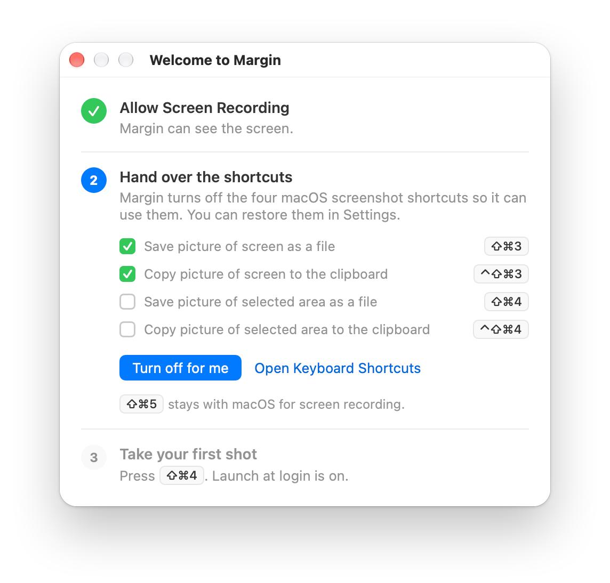
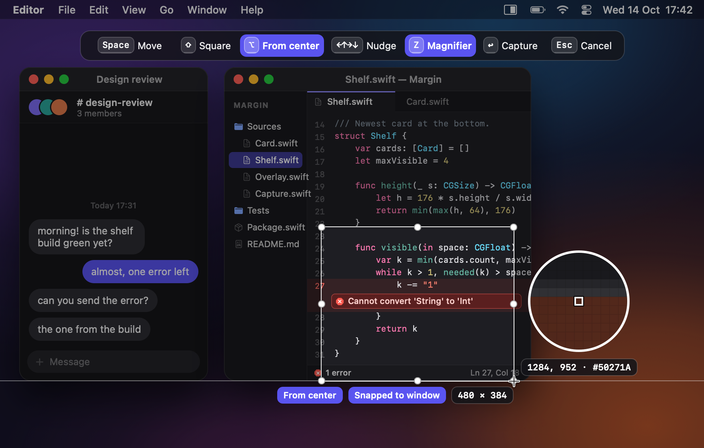
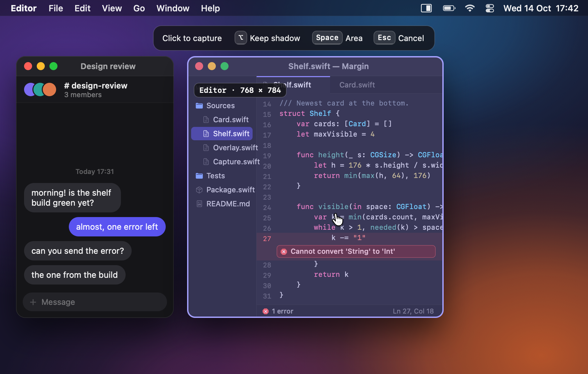
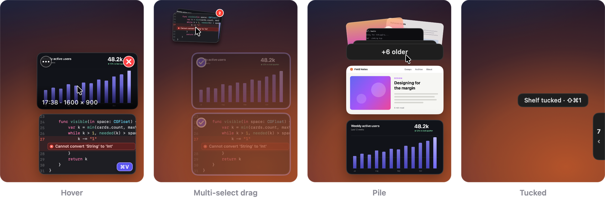
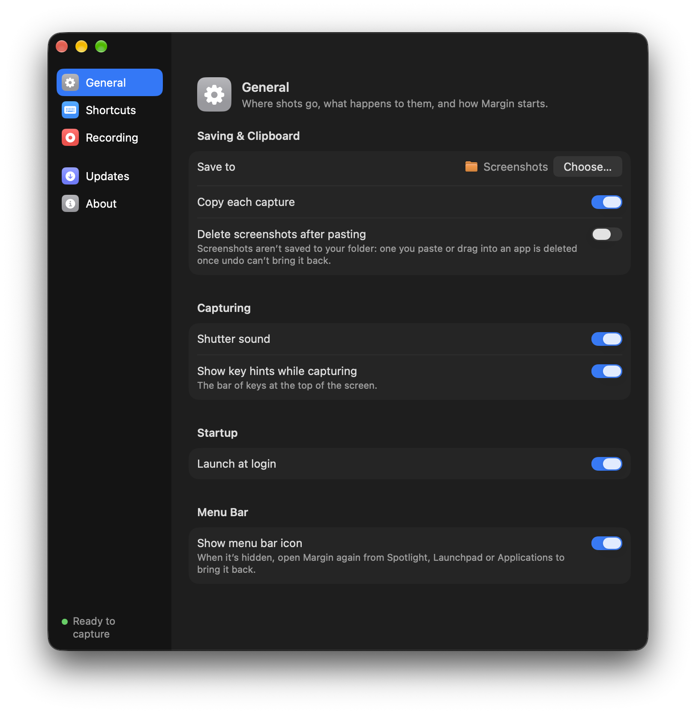

# Margin user guide

Margin is a menu bar app. Every capture is saved as a PNG, copied to the clipboard and put on a **shelf** of thumbnails (**cards**) at the right edge of the screen, where it waits until you drag it into another app or dismiss it.

This guide covers Margin 0.0.7. Shortcuts are shown with their defaults; you can change them in [Settings](#settings).

**Contents**

- [The menu bar icon](#the-menu-bar-icon)
- [First run](#first-run)
- [Capturing an area](#capturing-an-area)
- [Capturing a window](#capturing-a-window)
- [Full screen and repeat last area](#full-screen-and-repeat-last-area)
- [What happens when you capture](#what-happens-when-you-capture)
- [The shelf](#the-shelf)
- [Working with cards](#working-with-cards)
- [Undo](#undo)
- [Settings](#settings)
- [Displays, Spaces and accessibility](#displays-spaces-and-accessibility)

## The menu bar icon

Margin has no Dock icon. Everything is in its menu bar icon, a small rectangle with a filled right half:

| Item | What it does |
|---|---|
| Capture Area ⇧⌘4 | Start an area capture |
| Capture Window | Start a capture in window mode |
| Capture Screen ⇧⌘3 | Capture the display under the pointer |
| Repeat Last Area ⇧⌘2 | Capture the last area again |
| Tuck Shelf / Show Shelf ⇧⌘1 | Tuck the shelf away, or bring it back (dimmed while the shelf is empty) |
| Restore Last Removed | Bring back the card(s) that last left the shelf |
| Open Screenshots Folder | Open the save folder in Finder (creating it if needed) |
| Settings… | Open Settings |
| About Margin | Version and copyright |
| Quit Margin | Quit |

Captures started from the menu wait for the menu to close, so the menu is never in the shot.

**When something needs attention**, an orange dot appears on the icon and the menu gains an item at the top:

- **Allow Screen Recording…** (replaces Capture Area): Margin can't see the screen. It opens [first run](#first-run) at step 1. If permission was lost while Margin was running, **Relaunch Margin** appears below it.
- **"⇧⌘4 is used by another app — Change in Settings…"** (or "…is set for two actions", "…isn't available"): a shortcut couldn't be registered. It opens Settings.

A quieter item, with no dot, sits above Settings… while macOS still owns one of Margin's shortcuts: **macOS still uses ⇧⌘4 — Fix…**. It opens first run at step 2.

Opening Margin again from Finder or Spotlight while it's running opens Settings, or the permission step if permission is missing.

## First run

The **Welcome to Margin** window shows on first launch, and whenever Screen Recording permission is missing. Each step shows as done, current or to do; click a step that's still to do to open it.

1. **Allow Screen Recording.** Click **Allow…** and macOS asks once. Then turn Margin on in System Settings › Privacy & Security › Screen & System Audio Recording (**Open Privacy Settings** takes you there). If macOS doesn't pick it up, click **Relaunch Margin**.
2. **Hand over the shortcuts.** A live checklist shows the four macOS screenshot shortcuts, ticking each one as it turns off:

   | macOS shortcut | Keys |
   |---|---|
   | Save picture of screen as a file | ⇧⌘3 |
   | Copy picture of screen to the clipboard | ⌃⇧⌘3 |
   | Save picture of selected area as a file | ⇧⌘4 |
   | Copy picture of selected area to the clipboard | ⌃⇧⌘4 |

   Click **Turn off for me** and Margin turns all four off. The change applies at once, with no logout, and **Restore macOS screenshot shortcuts** in Settings undoes it. To untick them yourself instead, click **Open Keyboard Shortcuts** and go to Keyboard Shortcuts… › Screenshots. ⇧⌘5 stays with macOS for screen recording.
3. **Take your first shot.** Press ⇧⌘4. The step also says whether launch at login is on, or waiting for your approval (with an **Open Login Items** button).

After your first successful capture the window shows "You're set" and closes. If macOS still owns some of the shortcuts, it says so and leaves you a few seconds to read it.

## Capturing an area

Press **⇧⌘4**. The screen freezes on every display and the pointer becomes a crosshair.

- **Drag** over what you want and **let go**: that's the capture. There's no confirm step.
- A drag smaller than 4 × 4 pixels is ignored, and you can try again.
- A selection stays on the display where you started it.
- The **size pill** under the selection shows its size in pixels, `W × H`.

While dragging:

| Hold | Effect | Pill |
|---|---|---|
| ⇧ | Makes a square | "Square" |
| ⌥ | Grows the selection around where you started | "From center" |
| Space | Moves the selection instead of resizing it | |

**Fine-tune before capturing.** Press an arrow key *before* you let go of the mouse. The selection then stays when you release, and you can:

- drag any of its handles to resize it (the edge handles appear once it's at least 40 pt on each side);
- drag inside it to move it;
- nudge it with the arrow keys: 1 px per tap, faster while held (2 px, then 4 px), or 10 px with ⇧;
- press **↩** to capture it.

**Snapping.** Edges snap to the edges of windows within 8 pt. Thin guide lines and a "Snapped to window" pill show while they're snapped. ⇧ (square) turns snapping off.

**Magnifier.** Press **Z** to show an 11 × 11 pixel grid around the pointer, labelled with the pixel's position on that display and its colour, e.g. `812, 344 · #1E1E24`. Press Z again to hide it. It's off at the start of every capture.

**Hint bar.** A bar at the top of the screen lists the keys (turn it off with Settings › Show key hints while capturing): Space Window, ⇧ Square, ⌥ From center, ←↑→↓ Nudge, Z Magnifier, ↩ Capture, Esc Cancel. The key you're holding is highlighted. While you drag, "Space Window" becomes "Space Move". The bar steps aside if your selection reaches under it.

**Cancelling.** Press **Esc** or right-click. Nothing is saved, no sound plays and the clipboard is unchanged. Switching apps with ⌘Tab, or a display change, also cancels.

A display that macOS can't capture (some Sidecar, AirPlay or DisplayLink setups) is dimmed with the note "Can't capture this display"; select on another display.

## Capturing a window

Press **Space** during an area capture (before you start dragging), or choose **Capture Window** from the menu bar.

- The window under the pointer is highlighted, with a pill such as `Safari · 2880 × 1800` (pixels).
- **Click** to capture just that window, even if other windows partly cover it. The shot has transparent rounded corners and no shadow.
- **⌥-click** to keep the window's shadow. While ⌥ is held, "Keep shadow" lights up in the hint bar and the pill adds "· shadow".
- **Space** goes back to area mode. **Esc** or a right-click cancels.

## Full screen and repeat last area

- **⇧⌘3** captures the whole display under the pointer, with no overlay.
- **⇧⌘2** captures the same rectangle as your last area capture, with no overlay, then briefly outlines it (150 ms). The area stays on the same part of the same display even if you add, remove or rearrange displays. If there's no last area, or its display is gone or at another resolution, it starts a normal area capture instead.
- **⌃⇧⌘4, ⌃⇧⌘3 and ⌃⇧⌘2** do the same as without ⌃. On macOS ⌃ means "to the clipboard", and every Margin shot is already copied.

If a capture fails, the shelf says so: "Couldn't capture that window" (it closed before the click), "Couldn't capture this display", "Couldn't capture that area" or "Couldn't capture the screen".

## What happens when you capture

The moment you let go:

1. The shutter sound plays: the system's own Screen Capture sound, at your alert volume. It's silent when Settings › Shutter sound is off, or when "Play user interface sound effects" is off in System Settings › Sound.
2. The shot **flies** from where it was on screen to its slot on the shelf (about half a second), and the new card gets a violet ring for 1.5 s.
3. It's saved as a PNG in your save folder, `~/Desktop/Screenshots` by default:
   - names look like `Screenshot 2026-10-14 at 17.42.17.png`, in 24-hour time;
   - two shots in the same second get ` (2)`, ` (3)` and so on;
   - the file appears in one piece, never half-written;
   - it keeps the display's colour profile, at 144 DPI on Retina displays;
   - it's tagged as a screenshot, the way macOS tags its own, so Finder's and Spotlight's screenshot searches find it.
4. It's copied to the clipboard as both the image and the saved file. See [the clipboard section in the README](../README.md#clipboard) for what each app pastes.

If the save folder can't be written, the shot goes to `~/Library/Application Support/Margin/Unsaved/` and the shelf shows "Saved to Unsaved — folder not writable". If it can't be saved at all, the card goes away with "Couldn't save the screenshot".

If you quit right after a capture, Margin waits (at most about 3 s) for the file to be written.

## The shelf

The shelf sits at the bottom-right of the display you last captured on, clear of the Dock and the menu bar. It's hidden while it's empty.

- **Cards** are 176 pt wide, and as tall as the shot's shape allows (64–176 pt). The newest is at the bottom; older ones slide up.
- **Hovering** a card enlarges it slightly and shows:
  - a red **✕** at the top-right, to dismiss it;
  - the **•••** Options button at the top-left, for its menu;
  - the time and pixel size along the bottom, e.g. `17:42 · 1280 × 800`.
- **The pile.** At most four cards show (fewer on a short screen). Older shots fold into a `+N older` **pile** above them. Hover it to fan out the newest few, drag it to send all of them, or right-click it for **Clear shelf**.
- **The ⌘V mark.** A small violet **⌘V** pill sits on the card whose image is on the clipboard. It goes away within a second of copying something else.
- **Toasts.** Short messages appear above the top card for about a second: "Copied", "Path copied", "Restored", "Shelf tucked · ⇧⌘1" and errors. They're never system notifications.
- **Tucking.** **⇧⌘1** slides the shelf off the edge, leaving a narrow **tab** with the number of shots. Hover the tab to peek at the shelf, and click it (or press ⇧⌘1 again) to bring the shelf back. New shots fly into the tab while it's tucked, and the count goes up. An empty shelf can't be tucked.

The shelf never takes focus from the app you're working in. Clicking a card copies it and leaves the keyboard where it was, so ⌘V right after the click pastes the shot. The shelf's own keys (⌘Z, ⌫, Space, ⌘C, ⌘A) work after you ⌘-click a card, click ✕ or the pile, or choose Rename…, Move to Trash or Clear shelf. Esc, copying, tucking the shelf, or clicking anywhere else hands the keys back.

The shelf survives quitting and restarting.

## Working with cards

| Do this | To |
|---|---|
| Click | Copy the shot (shows "Copied" and moves the ⌘V mark) |
| Double-click | Open it in its default app (its first click copies it, too) |
| Drag | Send the file to another app |
| ⌘-click | Add it to, or remove it from, the selection |
| ⌘A | Select every card that isn't in the pile |
| ⌘C | Copy the selected cards (or the one under the pointer, or the last one clicked) |
| Space | Quick Look; Space or Esc closes it |
| ⌫ (or ⌦) | Dismiss; the file stays on disk |
| Two-finger swipe right | Dismiss |
| ✕ | Dismiss |
| ••• or right-click (or ⌃-click) | Open the card's menu |
| Esc | Close Quick Look; otherwise clear the selection and hand the keys back to your app |

**Dragging out.** A card drags as a plain file, so any app that takes files takes it: Finder, Slack, Chrome, WhatsApp, Claude, Notes, a terminal (which types the path).

- While you drag, the card stays faint in its slot.
- When the drop lands, the card leaves the shelf; if you cancel, it springs back.
- **Hold ⌥ when you drop** to keep the card on the shelf. The dragged image shows "Keep on shelf" while ⌥ is down.
- Dragging a selected card drags the whole selection, as a stack with a count badge.

Margin never moves or deletes a file because of a drag. "The drop landed" only means the card leaves. If an app wrongly says a drop worked, ⌘Z brings the card back. If it wrongly says the drop failed, the card stays, and ⌫ removes it.

**The card menu:**

- **Copy Path** (or **Copy Paths** for a selection): the path as plain text.
- **Reveal in Finder.**
- **Rename…**: edit the name in place on the card. ↩ saves (the file is renamed on disk), Esc cancels, and clicking elsewhere keeps what you typed (so does tucking the shelf, or a new shot pushing the card into the pile). The usual text shortcuts (⌘X, ⌘C, ⌘V, ⌘A, ⌘Z, ⇧⌘Z) work while you type.
- **Move to Trash**: the file goes to the Trash and the card leaves. ⌘Z puts both back (after Finder's Put Back, it just brings the card back).

**Files changed outside Margin.** Cards follow files you rename or move in Finder. A card whose file was deleted or moved to the Trash drops off the shelf the next time Margin checks: at launch, when the shelf appears, and when you start dragging. Shots on an external disk or a network share stay while it's disconnected, and work again once it's back.

## Undo

**⌘Z** on the shelf brings back the card(s) that last left it. Right after ✕, Move to Trash or Clear shelf the shelf already has the keys; otherwise ⌘-click a card or click the pile first. It remembers up to 20 removals: drag-outs, dismissals, Clear shelf and Move to Trash (the file comes back from the Trash too). A card whose file you've deleted since can't come back: ⌘Z says "File not found", and the next ⌘Z goes on to the removal before.

**Restore Last Removed** in the menu bar does the same, without clicking the shelf first.

## Settings

| Setting | What it does |
|---|---|
| Save to | Where screenshots go. **Choose…** picks a folder; it's created if missing |
| Copy each capture | Put every capture on the clipboard (on by default) |
| Shutter sound | Play the capture sound (on by default) |
| Show key hints while capturing | Show the bar of keys at the top of the screen while you capture (on by default) |
| Launch at login | Open Margin when you log in (on by default). If macOS wants your approval, a line with **Open Login Items** appears |
| Shortcuts | Capture area, Capture screen, Repeat last area, Show or tuck shelf |
| macOS screenshot shortcuts | Shows whether macOS still owns ⇧⌘3 / ⇧⌘4, with **Turn off macOS screenshot shortcuts** or, once they're all off, **Restore macOS screenshot shortcuts** |

**Changing a shortcut.** Click its button, then press the new keys.

- The shortcut needs ⌘ or ⌃; ⇧ and ⌥ alone aren't enough.
- ⌘ or ⌃ with just one key (⌘Q, ⌘V, ⌃C…) is refused, because Margin would take it from every app; F1–F20 are fine.
- Shortcuts macOS or most apps already use are refused too, with the reason: ⇧⌘Z (Redo), ⇧⌘5 (the screenshot toolbar), ⌃⌘Q (Lock Screen), ⌥⌘⎋ (Force Quit) and the like, plus any system shortcut you've set in System Settings › Keyboard › Keyboard Shortcuts.
- **Esc** cancels and **Delete** resets it to the default.
- Margin refuses a shortcut that another of its actions already uses.
- While a button is listening, Margin's shortcuts are paused, so you can record the current one.
- The ⌃ twins follow automatically.
- Window capture is always Space after the area shortcut.
- If a shortcut can't be registered (another app has it), a warning shows under it.
- Shortcuts are shown with the letters of your keyboard layout: on a German keyboard the key right of T reads Z. Switch input source and Settings and the menu follow.

## Displays, Spaces and accessibility

- **Several displays.** Area capture freezes every display at once. The shelf moves to the display of your latest capture, and repositions when a display is added or removed.
- **Spaces and full-screen apps.** The shelf and the capture overlay appear on every Space and above full-screen apps.
- **Light and dark mode** are both supported.
- **Reduce Motion:** there's no fly-in; new cards appear in place, and cards stop springing.
- **Reduce Transparency:** the pile, the tab and the toasts use a solid background instead of Liquid Glass.

Margin's own windows (the shelf, the overlay, toasts, the fly-in) never appear in its captures. To check what the shelf looks like on screen, use macOS's `screencapture -x`, which does see it.
